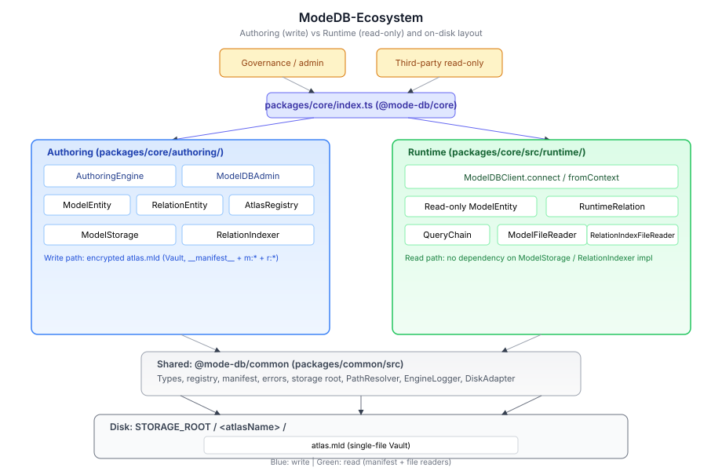

# Mode DB Engine

一个**超关系型数据引擎**，用于数据治理与数据资产图谱构建。

它不依赖传统数据库的主外键机制来关联数据，而是通过**物理关系**将实体连接在一起——模型只存储纯净的属性数据，关系作为独立的四元组协议存在，两者在物理层面完全隔离。

代码库在 **2.0** 之后分为三条交付线：

- **Authoring（治理端）**：建模、插入、显式绑定索引；落盘为加密 **单文件 Vault `atlas.mld`**（包内 **`__manifest__`**、**`m:<Model>`**、**`r:<…>`** 等逻辑键），**不再**使用根级 **`atlas-manifest.json`** 或 **`models/`**、**`relations/`** 分路径树。
- **Runtime（客户端）**：按图谱名只读打开 **`atlas.mld`**，经 **`VaultModelFileReader` / `VaultRelationIndexReader`** 与包内 **`__manifest__`** 工作（密钥与治理端一致，常见为 **`MODEL_DB_VAULT_SECRET`** 或与 **`connectToken`** 派生的集成配置）。不依赖写入路径，适合独立交付。
- **Network（可选）**：**`ModelDB WebSocket Server`** 在指定存储根上托管只读查询；**`@mode-db/sdk`** 通过 **`connectRemote`** 提供与本地 **`model.query()…execute()`** 相同的链式 API，查询体经 **ConnectToken 握手** 与 **会话密钥混淆** 传输（详见下文 **「网络服务与远程客户端 SDK」**）。

**运维入口**：**`modeldb.config.json`**、**`npm run start:server`**、**`npm run ignition`** 与全部参数说明见下文 **「运行与配置（工作区、启动命令、参数与环境）」**。

> 本项目处于早期设计与实现阶段。

---

## 核心理念

### 为什么不用主外键？

传统关系型数据库通过在模型中嵌入外键（`user_id`、`department_id`）来表达关联。这种做法将**关系信息污染到了模型本身**，导致：

- 模型字段随关系增多而膨胀
- 关系变更需要修改模型表结构
- 难以表达多对多、层级继承等复杂拓扑

Mode DB Engine 采用完全不同的思路：

```
传统方式:  User { name, email, department_id }     ← 外键嵌入模型
本引擎:    User { name, email }                     ← 模型纯净
           Relation(User → Department, "属于", "包含")  ← 关系独立存储
```

### 五条铁律

| 规则         | 说明                                                                                           |
| ------------ | ---------------------------------------------------------------------------------------------- |
| **模型纯净** | 模型只存储属性，严禁存储外键、状态位或 ID 关联                                                 |
| **关系纯粹** | 关系仅为四元组协议 `(Source, Target, Forward, Reverse)`，不存数据                              |
| **继承锁定** | 子模型在创建时锁定 `parentId`，且不可更改                                                      |
| **链式查询** | 查询通过模型跳转 ID 集合，最后才进行数据填充（Lazy Hydration）                                 |
| **存储隔离** | 模型与关系索引在 Vault 包内逻辑分离（**`m:*`** / **`r:*`**），物理上同包加密为 **`atlas.mld`** |

### 2.0 核心原则

| 原则         | 说明                                                                                              |
| ------------ | ------------------------------------------------------------------------------------------------- |
| **原子注册** | 模型注册通过 `AuthoringEngine` 统一入口，同步初始化 Registry 与 Storage                           |
| **骨架优先** | 支持先注册空壳模型/关系，后期通过 `updateFields` / `updateLogic` 补全定义                         |
| **双向守恒** | 关系必须以「正向/逆向」四元组成对存在；索引写入与删除保证正向/逆向成对                            |
| **显式绑定** | 索引构建不随 `insert` 自动触发；支持 GLOBAL、PROTOCOL、CONDITIONAL、MANUAL，通过 `bind` 显式执行  |
| **物理隔离** | 模型属性与关系邻接表在 Vault 内分键存放，经 **`flushAll()`** 一致落盘；对外仅暴露单一加密文件     |
| **图谱隔离** | 每个 **Atlas（图谱）** 在存储根下独占目录；多图谱并行时数据与 manifest 互不干扰                   |
| **双轨 OO**  | 「点」：`engine.model(name)` → `ModelEntity`；「线」：`engine.relation(label)` → `RelationEntity` |
| **双向对称** | `engine.relation('located_in')` 与 `engine.relation('contains_equip')` 共享同一底层定义，操作等价 |

---

## 架构：Authoring 与 Runtime

### 系统架构图

下图概括调用方向与落盘关系：**Runtime 只读路径**经 **`VaultModelFileReader` / `VaultRelationIndexReader`** 读取解密后的 **`atlas.mld`** 与包内 **`__manifest__`**；不经过 `ModelStorage` / `RelationIndexer` 的写入实现。

为在各类 Markdown 预览（含不支持 Mermaid 的环境）中稳定显示，架构图使用仓库内的 **SVG** 矢量图；图中标注为英文以避免字体与编码差异导致乱码。



源文件：[docs/architecture.svg](docs/architecture.svg)（可直接用浏览器或设计工具打开编辑。）

### 模块目录对照（文本）

```
┌─────────────────────────────────────────────────────────────────────────┐
│                         index.ts（包入口）                                │
├────────────────────────────────────┬────────────────────────────────────┤
│  Authoring（治理端）                 │  Runtime（客户端 / 可独立分包）      │
│  authoring/                        │  src/runtime/                      │
│  ├─ engine.ts      AuthoringEngine │  ├─ ModelDBClient.connect(atlas)   │
│  ├─ admin.ts       ModelDBAdmin    │  ├─ ModelEntity（只读）             │
│  ├─ entity.ts      ModelEntity     │  ├─ RuntimeModel / RuntimeRelation │
│  ├─ relation-entity.ts             │  ├─ VaultModelFileReader                     │
│  ├─ storage.ts     ModelStorage    │  ├─ VaultRelationIndexReader                 │
│  ├─ indexer.ts     RelationIndexer │  └─ query.ts → QueryChain          │
│  ├─ atlas-single-vault.ts (Vault)  │                                    │
│  └─ atlas-registry.ts              │                                    │
│                                    │  runtime/index.ts → 再导出上述 API   │
├────────────────────────────────────┴────────────────────────────────────┤
│  common/          共享类型、Registry 接口、manifest、错误、存储根解析       │
│  src/common/      PathResolver（Atlas 下路径解析）                        │
│  packages/server/  ModelDB WebSocket 服务（commander CLI、配置、查询分发）   │
│  packages/sdk/     远程客户端 SDK（tsup → ESM/CJS + d.ts）                 │
│  packages/shared/  线协议编解码、握手/RPC 类型、远程查询计划（不依赖仓库根引擎包）   │
│  src/network/     线协议类型、execute 结果 JSON 序列化（供服务端/SDK 共用）   │
└─────────────────────────────────────────────────────────────────────────┘
                                      │
                    STORAGE_ROOT / <atlasName>/
                    └── atlas.mld                   # 加密包：__manifest__ + m:* + r:*
```

**约束**：`src/runtime/` 下的实现**不**依赖 `authoring/storage`、`authoring/indexer` 等写入侧模块；`ModelDBClient.connect()` 仅通过只读 Reader 与 Vault 包内 **`__manifest__`** 工作。

**别名**：`Engine` 为 `AuthoringEngine` 的兼容导出；`Runtime` 为 `ModelDBClient` 的兼容导出。

---

## 存储布局与 Atlas

默认存储根为 **`<cwd>/data`**（与 **`common/default-storage-root.ts`** 中 **`DEFAULT_STORAGE_ROOT`** 一致；可通过 **`MODEL_DB_STORAGE_ROOT`** / **`STORAGE_ROOT`** 或 **`configureModelDBStorageRoot`** 覆盖）。

每个 **Atlas（图谱）** 对应 **`STORAGE_ROOT/<atlasName>/`** 一级目录。**引擎仅支持单文件 Vault**：磁盘上为加密 **`atlas.mld`**；**`ModelDBClient.connect`** 通过文件头魔数 **`MDB4SVLT`**（**`fileLooksLikeAtlasSingleVault`**）识别 Vault，并使用 **`VaultModelFileReader` + `VaultRelationIndexReader`** 解密包内条目。

### 目录示例

```
data/
├── pipe/
│   └── atlas.mld              # 内含 __manifest__、m:Pump、m:Zone、r:Pump-Zone-located_in 等逻辑键
└── tran/
    └── atlas.mld
```

- **逻辑模型块**：包内键 **`m:<ModelName>`** 承载 **JSONL**（首行可为 **`__schema__`** header）。
- **逻辑关系索引**：键 **`r:<Source>-<Target>-<Forward>`**，值为 JSON **`fwd` / `rev`**，由 **`RelationIndexer`** 与 **`flushAll()`** 维护并写入 Vault。
- **清单**：键 **`__manifest__`**；**不再**使用根级 **`atlas-manifest.json`** 或 **`models/`**、**`relations/`** 分路径树。

治理端写入或更新图谱后，应调用 **`await engine.flushAll()`**，将缓冲、关系索引与 **`__manifest__`** 经 **`AtlasSingleVault.saveSync`** 写回加密包，以便 **`ModelDBClient.connect('图谱名')`** 读到最新数据。

### Vault 密钥与行为

| 项                 | 说明                                                                                                                                                                                                                                                                                   |
| ------------------ | -------------------------------------------------------------------------------------------------------------------------------------------------------------------------------------------------------------------------------------------------------------------------------------- |
| **治理端密钥**     | 构造 `new AuthoringEngine({ connectToken: '...' })`（由 **`deriveAtlasVaultSecretFromConnectToken`** 派生盘密钥），或显式 **`vaultSecret`** / **`process.env.MODEL_DB_VAULT_SECRET`**（须与 Runtime 一致）。                                                                           |
| **Runtime 密钥**   | **`ModelDBClient.connect(atlas)`** 使用 **`MODEL_DB_VAULT_SECRET`** 或与集成测试一致的 **`MODEL_DB_CONNECT_TOKEN`** 派生密钥（见 **`test/integration-vault.ts`**）。                                                                                                                   |
| **磁盘混淆**       | Vault 模式下 **`shadowDiskEncoding` 强制关闭**（内层已是密文包，不再对 JSONL 行做 shadow 编码）。                                                                                                                                                                                      |
| **透明 API**       | `getData()` / `getValue()` / `QueryEngine` 与链式查询仍返回**已解码的明文**；开发者不处理偏移或密文块。                                                                                                                                                                                |
| **内存隐匿**       | 可选 **`memoryShadowHydration`**：实体内部可存字段指针，`getValue` 按需解析；**`getData()` 仍返回明文行**（与对外 API 一致）。                                                                                                                                                         |
| **损坏与密钥错误** | 解密失败、截断或魔数不匹配时，`AtlasSingleVault` 经 **`DiagnosticCenter`** 上报 **`E3002`（`PHYSICAL_ADDRESS_CORRUPT` / `ErrorCodes.PHYSICAL_ADDRESS_CORRUPT`）**；`AuthoringEngine` 构造或 `connect` 会抛出 **`AtlasManifestError`**。若启用 **`engineLogger`**，诊断会异步写入日志。 |
| **冷启动**         | 治理端再次打开已有 Vault 时，从包内 **`__manifest__`** 解析并 **hydrate** `ModelRegistry` 与 `ModelStorage` schema（需默认 `AtlasRegistry`，勿与自定义 `registry` 混用）。                                                                                                             |
| **导出类型**       | 包入口另导出 **`AtlasSingleVault`**、**`fileLooksLikeAtlasSingleVault`**、**`ATLAS_SINGLE_VAULT_MAGIC`**，供工具或 CI 探测。                                                                                                                                                           |

下文 **「治理端持久化与开发者体验（DX）」** 描述写缓冲、定时调度与合并读；若仅需快速上手，可跳到 **「使用指南」**。

---

## 治理端持久化与开发者体验（DX）

### `updateFields(fields)` — 支持类型化字段

- **Legacy 入参**：`readonly string[]`；内部用 `new Set(fields)` **去重**，无类型元数据。
- **Typed 入参**：`Record<string, DataType | FieldTypeDef>`，如 `{ age: 'Int', name: 'I18N' }`；自动提取字段名集合与类型元数据。
- **效果**：同步更新 Registry 与 `ModelStorage` 的 schema（含 `fieldTypes`），与后续写入 Vault **`m:*`** 载荷的字段一致。

### DataType 协议与对象化类型系统（2.0）

引擎内置 9 种数据类型，通过 `DataType` 常量引用：

| 类型         | 说明                                                      |
| ------------ | --------------------------------------------------------- |
| **String**   | 普通字符串                                                |
| **I18N**     | 国际化字符串，存储为 `{ zh: '...', en: '...' }` 对象      |
| **Number**   | 浮点数                                                    |
| **Int**      | 整数（`Number.isInteger`）                                |
| **Boolean**  | 布尔值                                                    |
| **DateTime** | ISO 8601 格式字符串                                       |
| **JSON**     | 任意值（逃生舱口，不做校验）                              |
| **Color**    | 颜色值，接受 hex 字符串或 `{r,g,b,a?}` 对象               |
| **Unit**     | 带单位数值，存储为 `{value, unit}` 对象，支持基础单位换算 |

> **Enum 已移除**：引导用户使用关联模型（`registerRelation`）替代枚举约束。

**Schema 配置结构**：字段定义支持 `{ type, required?, default?, unit? }`：

```typescript
engine.registerModel('Task', {
  title: { type: 'String', required: true },
  status: { type: 'String', default: 'draft' },
  priority: { type: 'Int', required: true, default: 0 },
  color: 'Color',
});
```

**Pre-insert validation**：`insert()` / `update()` 时自动校验字段值与声明类型是否匹配；不匹配则抛出 `ValidationError`。未声明类型的字段（legacy `string[]` 路径）跳过校验。

**`required` 语义空值检查**：`required: true` 不仅拒绝 `null` / `undefined`，还拒绝类型特定的"空值"：

| 类型     | 空值定义                                    |
| -------- | ------------------------------------------- |
| String   | 长度为 0 或全空格（`"".trim().length===0`） |
| I18N     | 对象无任何语言 key（`{}`）                  |
| Color    | RGBA 通道缺失（`r/g/b` 非 number）          |
| Unit     | 数值部分为 NaN 或非 number                  |
| 其他标量 | 仅 `null` / `undefined`                     |

**`default` 值注入**：`insert()` 时，若字段缺失且定义了 `default`，自动填充后再进行类型校验。`default` + `required` 可组合使用——缺失时注入默认值，显式传入空值仍被拒绝。

**I18N 特殊处理**：

- 引擎配置 `currentLocale`（如 `new AuthoringEngine({ atlas: 'x', currentLocale: 'zh' })`）。
- **插入时**：若 I18N 字段传入 plain string，自动包装为 `{ [currentLocale]: value }`。
- **查询时**：`where('name', 'eq', '苹果')` 自动按 `currentLocale` 解析 `row.name[locale]` 进行比较。

**对象化类型系统（ValueObject）**：

所有高级类型均有对应的 `ValueObject` 子类，查询结果的 `HydratedEntity` 通过 `.getValue(field)` 返回类型化包装：

| ValueObject 子类 | DataType | 特有方法                                      |
| ---------------- | -------- | --------------------------------------------- |
| `I18NValue`      | I18N     | `.get(lang)`, `.set(lang, text)`, `.locales`  |
| `ColorValue`     | Color    | `.toHex()`, `.toCSS()`, `.getData()` → `RGBA` |
| `UnitValue`      | Unit     | `.value`, `.unit`, `.convertTo(targetUnit)`   |
| `StringValue`    | String   | `.getData()` → `string`                       |
| `NumberValue`    | Number   | `.getData()` → `number`                       |
| `IntValue`       | Int      | `.getData()` → `number`                       |
| `BooleanValue`   | Boolean  | `.getData()` → `boolean`                      |
| `DateTimeValue`  | DateTime | `.getData()` → `string`, `.toDate()` → `Date` |
| `JsonValue`      | JSON     | `.getData()` → `unknown`                      |

每个 `ValueObject` 提供：

- `.update(newValue, diagnostics?)` — 校验新值（含 `required` 语义空值检查）后写回模型缓冲区。传入 `diagnostics` 数组时收集而非抛出。
- `.save()` — 显式推送当前值到缓冲区（需 authoring 上下文）。
- `.isEmpty()` — 按类型特定语义判断当前值是否为空。

### DiagnosticCenter 诊断中心

引擎内置统一的诊断中心（单例），管理所有校验错误的生成、分级和国际化：

**Severity 分级**：

| 级别    | 含义                                         |
| ------- | -------------------------------------------- |
| `FATAL` | 引擎必须立即停止（如磁盘无法写入）           |
| `ERROR` | 数据行非法，但不影响其他行（如非空校验失败） |
| `WARN`  | 数据合法但有隐患（如 Color 格式已自动修复）  |

**ErrorRegistry（错误注册表）**：标准化错误码 `E1001`–`E3001`（含 `E2005`），每个码绑定 severity + 中英文消息模板。提供 `ErrorCodes` 命名别名：

| 别名                     | 码    | 含义                             |
| ------------------------ | ----- | -------------------------------- |
| `SCHEMA_REQUIRED`        | E1001 | 必填字段缺失（null / undefined） |
| `SCHEMA_REQUIRED_EMPTY`  | E1002 | 必填字段为语义空值               |
| `TYPE_MISMATCH`          | E1003 | 数据类型不符                     |
| `UNKNOWN_TYPE`           | E1004 | 未知 DataType                    |
| `I18N_MISSING_LOCALE`    | E1005 | I18N 字段缺少 locale             |
| `COLOR_AUTO_COERCED`     | E1006 | Color 格式非标准，已自动修复     |
| `VO_NO_SYNC`             | E1007 | ValueObject 无同步回调           |
| `IO_PERSISTENCE_FAIL`    | E1008 | 磁盘写入失败（FATAL）            |
| `MODEL_NOT_REGISTERED`   | E1009 | 模型未注册                       |
| `BATCH_ROW_FAIL`         | E1010 | 批量行校验失败                   |
| `DEFAULT_INJECTED`       | E1011 | 默认值已注入（WARN）             |
| `SELF_REFERENTIAL_CYCLE` | E2005 | 自关联死循环                     |
| `VALUE_RANGE_OVERFLOW`   | E3001 | 数值超出允许范围                 |

**双模式校验**：

- **throw 模式**（默认）：`DiagnosticCenter.report(code, ctx)` 抛出对应的 `ValidationError` / `EngineError`。
- **collect 模式**：`DiagnosticCenter.report(code, ctx, 'collect', bag)` 将 `Diagnostic` 推入数组，不中断执行。
- **severity 覆盖**：`report()` 第五参数可传入 `severityOverride` 升降级。

**ValidationReport**：批量操作的结构化结果，包含逐行成功/失败状态和诊断详情：

```typescript
const report = await model.insertMany([
  { name: 'Alice', age: 25 },
  { name: '', age: 30 }, // required 空值 → 失败
  { name: 'Bob', age: 'x' }, // 类型错误 → 失败
]);

report.ok; // false — 等同于 report.isAllSuccess()
report.successCount; // 1
report.failureCount; // 2
report.failed[0].diagnostics; // Diagnostic[] with code, severity, message
report.errors(); // 所有 ERROR/FATAL 诊断
report.warnings(); // 所有 WARN 诊断
report.getSummary(); // { total, successCount, failureCount, errorCodes, hasFatal }
report.exportAsJSON(); // 可序列化 JSON 快照（不含 data 负载）

// 流式收集：管道式追加全局诊断
const streamReport = new ValidationReport();
streamReport.report(DiagnosticCenter.create('E1001', { field: 'id', received: 'null' }));
streamReport.allDiagnostics(); // [Diagnostic]
```

**自动刷盘异常捕获**：后台 `flushAll` 遇到磁盘写入错误时，引擎会：

1. 通过 `DiagnosticCenter` 发出 `IO_PERSISTENCE_FAIL` (E1008) FATAL 级别报告。
2. 将当前缓冲区数据紧急导出到 `<model>.dump` 文件，防止数据丢失。

**国际化**：`DiagnosticCenter.locale = 'zh'` 切换后，所有诊断消息自动使用中文模板。

**监听器**：`DiagnosticCenter.onDiagnostic(fn)` 订阅所有诊断事件（日志 / 遥测）。

**元数据持久化**：

- Vault 内 **`m:<Model>`** JSONL 首行可为 **`__schema__`** header（JSON），包含 `fields` 与 `fieldTypes`；读取时自动跳过。
- 包内 **`__manifest__`** 的 model 条目携带可选 **`fieldTypes`**，与 header 对齐。

```typescript
import { AuthoringEngine, DataType, I18NValue, ColorValue, UnitValue } from 'mode-db-engine';

const engine = new AuthoringEngine({ atlas: 'typed', currentLocale: 'zh' });

// 方式 A：registerModel 时直接传入类型化字段
engine.registerModel('Product', {
  name: 'I18N',
  price: 'Number',
  active: 'Boolean',
  color: 'Color',
  weight: { type: 'Unit', unit: 'kg' },
});

// 方式 B：骨架优先 + updateFields 补全
engine.registerModel('Order');
engine.model('Order').updateFields({
  total: 'Int',
  createdAt: 'DateTime',
});

// 插入时自动校验 + I18N 自动包装 + Color/Unit 校验
const p = await engine.model('Product').insert({
  name: '苹果',
  price: 9.9,
  active: true,
  color: '#ff0000',
  weight: { value: 0.2, unit: 'kg' },
});
// p.name → { zh: '苹果' }

// 查询时 I18N 字段按 locale 解析
const hits = await engine.model('Product').query().where('name', 'eq', '苹果').execute();

// 对象化访问
const entity = hits[0]!;
const nameVO = entity.getValue('name') as I18NValue;
nameVO.get('zh'); // '苹果'

const colorVO = entity.getValue('color') as ColorValue;
colorVO.toHex(); // '#ff0000'
colorVO.toCSS(); // 'rgb(255, 0, 0)'

const weightVO = entity.getValue('weight') as UnitValue;
weightVO.convertTo('g'); // 200
```

### 写缓冲（Write-Behind，`Map<_id, ModelRecord>`）

- **`PersistenceManager`** 维护 `recordBuffers: Map<modelName, Map<recordId, ModelRecord>>`；同一 `_id` 再次写入时**覆盖**为较新行。
- **`ModelEntity`**：`private readonly _buffer` 与 `getOrCreateModelBuffer(name)` 为**同一引用**。
- **`AtlasRegistry.model(name)`**：**缓存** `ModelEntity` 实例，多次 `engine.model('Pump')` 返回**同一对象**，保证写缓冲与 `insert` 状态连续。

### 自动化调度与进程收尾

- **200ms 定时器**：`AuthoringEngine` 构造时启动 `setInterval`。若 `persistence.hasBufferedRows()` 为真，则调用 **`flushPendingToDisk()`**（将模型缓冲写入 Vault **`m:*`** 并 **`saveSync`**；完整关系索引与 **`__manifest__`** 由 **`flushAll()`** 等路径统一落盘）。
- **`beforeExit`**：`process.once('beforeExit', () => void engine.flushAll())`，在进程即将退出事件循环前尽力执行 **`flushAll()`**（缓冲 → 模型 **`m:*`** 载荷 → 关系 **`r:*`** → **`__manifest__`**，再加密落盘）。
- **信号**：`registerAuthoringShutdownTask` 在 **SIGINT / SIGTERM** 时调用各引擎注册的 **`flushAll()`**。
- **`process.on('exit')`** 中无法可靠执行异步 IO；强一致落盘请使用 **`insert(..., { sync: true })`** 或显式 **`await engine.flushAll()`**。

### 合并读与 `QueryEngine`

- **`MergedDataReader`**：`getAll` / `getByIds` / `scanModelRecords` 合并磁盘行与 `getPendingSnapshot`；**同一 `_id` 以缓冲为准**；**`__deleted` 墓碑行被自动过滤**。
- **`findFirstByFieldEq`**：**先**查缓冲，**再**扫磁盘，避免未刷盘行被磁盘旧行抢先命中；已删除行不会命中。
- **`mergeDiskRowsWithAuthoringBuffer(diskRows, pendingById)`**（`src/runtime/query-engine.ts`）：与「磁盘行 + 缓冲 Map」合并语义一致，**`__deleted` 行被过滤**，便于工具层复用。
- **`QueryEngine.execute`** 与 **`evaluate`** 等价（单行谓词）；**完整查询**行集由 **`DataReader`**（已合并）再进入 `QueryChain.execute` / 聚合，**sum / avg** 等与合并后视图一致。

### CRUD 操作与缓冲区协议

引擎完整支持 **Create / Read / Update / Delete**，所有写操作遵循同一套「自动驾驶」缓冲区协议：

| 操作             | ModelEntity 方法                    | AuthoringEngine 方法                              | 说明                                                        |
| ---------------- | ----------------------------------- | ------------------------------------------------- | ----------------------------------------------------------- |
| **Create**       | `insert(data, opts?)`               | `engine.insert(model, data, opts?)`               | 新行入缓冲；合并读即时可见                                  |
| **Update**       | `update(id, partial, opts?)`        | `engine.update(model, id, partial, opts?)`        | 合并已有行（缓冲优先，磁盘回退）；`_id` / `_createdAt` 不变 |
| **Delete**       | `delete(id, opts?)`                 | `engine.delete(model, id, opts?)`                 | 缓冲写入 `__deleted` 墓碑；查询立即不可见                   |
| **Batch Update** | `updateWhere(pred, partial, opts?)` | `engine.updateWhere(model, pred, partial, opts?)` | 复用 `QueryEngine` 匹配后逐行 update                        |
| **Batch Delete** | `deleteWhere(pred, opts?)`          | `engine.deleteWhere(model, pred, opts?)`          | 复用 `QueryEngine` 匹配后逐行 delete                        |

- 所有写操作均支持 **`{ sync: true }`**，在 promise resolve 前执行 `flushModelToDisk`。
- **`update` 不存在的 id** → 返回 `undefined`；**`delete` 不存在 / 已删除的 id** → 返回 `false`。
- **`updateWhere` / `deleteWhere`** 接受 `PredicateNode`（谓词树），与 `QueryChain.where()` 语义一致。

### 删除的物理语义

- `delete` 在缓冲中写入 **`{ _id, _createdAt, __deleted: true }`** 墓碑。
- **关系层清理**：`delete` / `deleteWhere` 自动调用 **`RelationIndexer.purgeEntityFromAllRelations`**，移除该实体在所有关系索引（包内 **`r:*`**）中的正向与反向边。**严格遵循模型独立性**：仅清理被删实体自身的链接，**绝不**删除关联模型的数据行。
- **合并读**（`MergedDataReader` / `mergeDiskRowsWithAuthoringBuffer`）自动过滤 `__deleted` 行，查询**立即**生效。
- **flush 时压缩**：当缓冲中存在墓碑行，`flushModelToDisk` 触发 **全量重写**（读取 Vault 内模型块 → 合并缓冲 → 过滤墓碑 → 原子写回），**`m:*`** 明文 JSONL 中**不会残留** `__deleted` 行。
- **`DELETED_SENTINEL`** 常量（`'__deleted'`）与 **`isDeletedRecord(row)`** 工具函数已从 `common/types.ts` 导出。

### `insert` 与可选 `{ sync: true }`

- **默认**：`await model.insert(data)` 将行放入写缓冲；同进程内 **`await query().execute()`** 可通过合并读立即看到新行，**不必**先 `flushAll`。
- **`{ sync: true }`**：`await model.insert(data, { sync: true })` 或 `await engine.insert(modelName, data, { sync: true })` 在该 promise **resolve 前**对该模型执行 **`flushModelToDisk`**（将该模型当前缓冲批量写入 Vault **`m:*`**）。适用于**财务 / 强一致**等场景。
- **风险**：未刷盘前进程崩溃可能丢失缓冲内数据；跨进程读 Vault 或 **`existsSync('atlas.mld')`** 断言前，须 **`flushAll`** 或写操作加 **`{ sync: true }`**。

### 代码示例（治理端 CRUD）

```typescript
import { AuthoringEngine } from 'mode-db-engine';

const engine = new AuthoringEngine({ atlas: 'my_atlas' });
engine.registerModel('Item', new Set(['id', 'name', 'status', 'score']));

const Item = engine.model('Item');

// Create
const row = await Item.insert({ id: 'i1', name: 'A', status: 'active', score: 10 });

// Read（合并读，无需 flushAll）
const results = await engine.query('Item', [row._id]).execute();

// Update（部分字段合并，_id / _createdAt 不变）
const updated = await Item.update(row._id, { score: 99 });

// Delete（墓碑写入缓冲，查询立即不可见）
await Item.delete(row._id);

// Batch Update / Delete（谓词匹配）
await Item.updateWhere(
  { type: 'atom', field: 'status', op: 'eq', value: 'active' },
  { status: 'archived' },
);
await Item.deleteWhere({ type: 'atom', field: 'status', op: 'eq', value: 'archived' });

// 强制同步刷盘
await engine.flushAll();
```

**Runtime**：`ModelDBClient.connect(atlas)` **无** `insert` / `update` / `delete` / `updateFields` / `bind`，只读已落盘 Vault 与包内 **`__manifest__`**。

### 相关源码

| 模块                                                             | 路径                               |
| ---------------------------------------------------------------- | ---------------------------------- |
| 写缓冲、`flushPendingToDisk` / `flushModelToDisk`                | `authoring/persistence-manager.ts` |
| `ModelEntity`、`InsertOptions`、`UpdateOptions`、`DeleteOptions` | `authoring/entity.ts`              |
| `AuthoringEngine`、调度、`beforeExit`                            | `authoring/engine.ts`              |
| `mergeDiskRowsWithAuthoringBuffer`、`QueryEngine.execute`        | `src/runtime/query-engine.ts`      |
| 磁盘 + 缓冲合并读（含 `__deleted` 过滤）                         | `authoring/merged-data-reader.ts`  |
| `DELETED_SENTINEL`、`isDeletedRecord`、`ModelRecord`             | `common/types.ts`                  |

---

## 运行与配置（工作区、启动命令、参数与环境）

本节汇总 **如何在仓库内构建与启动**、**`modeldb.config.json` 各字段**、**`modeldb-server` CLI**、**环境变量**与 **`npm run ignition`** 压测点火；与 **`packages/server/src/config-loader.ts`** 实现一致。

### 当前系统能力速览（2.0）

| 能力           | 说明                                                                                                                |
| -------------- | ------------------------------------------------------------------------------------------------------------------- |
| **治理端**     | **`AuthoringEngine`**：模型/关系注册、写缓冲、**`flushAll`**；落盘为 **单文件 Vault（`atlas.mld`）**。              |
| **运行时**     | **`ModelDBClient.connect(atlas)`**：只读链式查询、合并读语义与本地一致。                                            |
| **网络层**     | **`@mode-db/server`**：**WebSocket** 上托管只读查询；**`@mode-db/sdk`**：**`connectRemote`** + 会话混淆（非 TLS）。 |
| **共享包**     | **`@mode-db/shared`**：线协议编解码等，供 server / SDK 共用。                                                       |
| **诊断与类型** | **`DiagnosticCenter`**、**`ValidationReport`**、**DataType / ValueObject** 等见上文各节。                           |

### 仓库工作区（npm workspaces）

| 包名                  | 路径              | 作用                                                                                                                                                                                                                       |
| --------------------- | ----------------- | -------------------------------------------------------------------------------------------------------------------------------------------------------------------------------------------------------------------------- |
| **`mode-db-engine`**  | 仓库根            | 引擎 **`dist/`**；根 **`package.json`** 聚合脚本与 **`bin.modeldb-server`**。                                                                                                                                              |
| **`@mode-db/shared`** | `packages/shared` | **Wire codec**、**传输帧**、**握手/RPC 类型**（**`tsup`**；**不**依赖 **mode-db-engine**）。                                                                                                                               |
| **`@mode-db/server`** | `packages/server` | **Fastify + ws**、配置加载、查询分发（**`tsc`** → `packages/server/dist/`）。**`package.json`** 不声明 **`mode-db-engine`**；源码在编译期以相对路径引用仓库根 **`dist/`** 下的已编译模块（须先 **`npm run build:lib`**）。 |
| **`@mode-db/sdk`**    | `packages/sdk`    | 远程客户端（**`tsup`** → ESM/CJS + **`.d.ts`**）。                                                                                                                                                                         |

根目录使用 **npm workspaces** 链接 **`@mode-db/sdk`** 等子包（**`devDependencies`** 等），便于 **`tsx`** 与脚本解析。**`@mode-db/server`** 与 **`@mode-db/sdk`** 的 **`package.json`** 以 semver 引用兄弟包；server 在编译后的 **`dist/`** 上链接根引擎产物；SDK 仅依赖 **`@mode-db/shared`**。根包名仍为 **`mode-db-engine`**，**`npm run build:lib`**（**`tsconfig.lib.json`**）产出根 **`dist/`**，再 **`build:server`**。

### 构建顺序

```bash
npm install
npm run build    # build:lib（根 tsconfig.lib.json → dist/）→ build:shared → build:server → build:sdk
```

单独构建：**`npm run build:lib`**（仅引擎）、**`npm run build:sdk`**、**`npm run build:server`**、**`npm run build:shared`**。

### 根目录常用 npm 脚本

| 脚本                                                               | 说明                                                                                                    |
| ------------------------------------------------------------------ | ------------------------------------------------------------------------------------------------------- |
| **`npm run build`**                                                | 编译引擎 + shared + server + sdk。                                                                      |
| **`npm run start:server`**                                         | 等价 **`node ./packages/server/dist/cli.js`**（无参时读取当前目录 **`modeldb.config.json`**，若存在）。 |
| **`npm run dev`**                                                  | 根目录引擎 **`tsc -p tsconfig.lib.json --watch`**。                                                     |
| **`npm test`** / **`npm run test:integration`**                    | 集成测试链（含配置加载审计，见 **`test/README.md`**）。                                                 |
| **`npm run ignition`**                                             | 双轨压测点火：**`test/dual_track_ignition.ts`**（需已启动 server，见下文）。                            |
| **`npm run typecheck`** / **`npm run lint`** / **`npm run check`** | 类型检查、ESLint、类型+lint+Prettier 检查。                                                             |
| **`npm run wire-server-audit`** 等                                 | 单项集成脚本，见 **`test/README.md`** 命令对照表。                                                      |

### `modeldb.config.json` 字段说明

将根目录 **[modeldb.config.example.json](modeldb.config.example.json)** 复制为 **`modeldb.config.json`** 并按环境修改（**勿**提交真实令牌与密钥）。

| 字段                               | 类型      | 说明                                                                                                                                                                                                       |
| ---------------------------------- | --------- | ---------------------------------------------------------------------------------------------------------------------------------------------------------------------------------------------------------- |
| **`port`**                         | `number`  | 监听端口；默认 **9090**（可被 CLI / **`MODEL_DB_PORT`** 覆盖）。                                                                                                                                           |
| **`host`**                         | `string`  | 绑定地址；默认 **127.0.0.1**。                                                                                                                                                                             |
| **`workspace`**                    | `string`  | **首选**：逻辑库工作区根目录；每个逻辑库为 **`<workspace>/<dbName>/`**（内含 **`atlas.mld`** 等）。合并顺序见 **`packages/server/src/config-loader.ts`**（**`workspace` → `storageRoot` → `dbPath`** …）。 |
| **`dbPath`**                       | `string`  | **兼容**：与 **`workspace`** 同语义（目录或 **`*.mld` 文件路径**）；为 **`.mld` 文件**时父目录为根，**`defaultAtlas`** = basename 去扩展名。                                                               |
| **`storageRoot`**                  | `string`  | **兼容**：显式存储根；与 **`workspace` / `dbPath`** 同一合并链。                                                                                                                                           |
| **`logDir`**                       | `string`  | 相对 **进程 cwd** 解析的日志目录；写入 **`system.log`**、**`access.log`**（当 **`accessLog`** 开启时）。                                                                                                   |
| **`bufferThreshold`**              | `number`  | 某模型暂存行数 ≥ 该值时触发该模型的 **`flushModelToDisk`**（服务端 **`AuthoringEngine`**）；可被 **`MODEL_DB_BUFFER_THRESHOLD`** 覆盖。                                                                    |
| **`cacheSize`**                    | `string`  | 当前版本为预留/提示（如 **`2GB`**），不参与核心逻辑。                                                                                                                                                      |
| **`mode`**                         | `string`  | 设为 **`"production"`**（不区分大小写）时启用 **`access.log`** 中的请求/解码/写门控等访问日志；等价于环境变量 **`MODEL_DB_ACCESS_LOG=true`**。                                                             |
| **`connectToken`**                 | `string`  | **必填（文件或环境或 CLI 其一）**：客户端握手 **`connectToken`** 须一致，否则断开。                                                                                                                        |
| **`vaultSecret`** / **`vaultKey`** | `string`  | 单文件 **`atlas.mld`** Vault 解密口令；可与 **`MODEL_DB_VAULT_SECRET`** 混用（别名 **`vaultKey`** 与 CLI **`--vault-key`** 相同语义）。                                                                    |
| **`dev`**                          | `boolean` | **`true`** 时与 CLI **`--dev`** 类似语义空间（详见 server 实现）；另 **`MODEL_DB_DEV`** 可参与解析。                                                                                                       |

解析后的 **`ResolvedModelDBServerConfig`** 另含 **`workspace`**（与 **`storageRoot`** 同路径，便于新代码命名）、**`defaultAtlas`**（仅当原始串指向 **`.mld`** 文件时）、**`bufferFlushRowThreshold`**、**`accessLog`**、**`serverLogDirectory`** 等派生字段。

### 配置优先级（与实现一致）

**同一键的合并顺序**为：**命令行（`commander` 传入的 overrides）→ `modeldb.config.json` → 环境变量 → 内置默认值**。

示例：**`port`** = `cli.port ?? file.port ?? MODEL_DB_PORT ?? 9090`；**`connectToken`** = `cli.connectToken ?? file.connectToken ?? MODEL_DB_CONNECT_TOKEN`（再 **trim**），若仍为空则 **抛错**。

未在 CLI 暴露的项（如 **`bufferThreshold`**）仅来自 **配置文件** 或 **`MODEL_DB_BUFFER_THRESHOLD`**。

### `modeldb-server` CLI 参数

入口：**`node ./packages/server/dist/cli.js`** 或 **`npm run start:server`** 或 **`npx modeldb-server`**（见根 **`package.json` → `bin`**）。

| 选项                                     | 说明                                                                               |
| ---------------------------------------- | ---------------------------------------------------------------------------------- |
| **`-c, --config <path>`**                | **`modeldb.config.json`** 路径；默认 **`./modeldb.config.json`**（相对 **cwd**）。 |
| **`-p, --port <number>`**                | 监听端口。                                                                         |
| **`-H, --host <host>`**                  | 绑定 host。                                                                        |
| **`-w, --workspace <path>`**             | 逻辑库工作区根（写入配置合并链的 **`workspace`**）。                               |
| **`-s, --storage <path>`**               | 兼容别名，同 **`--workspace`**。                                                   |
| **`--db-path <path>`**                   | 兼容别名，同 **`--workspace`**。                                                   |
| **`-t, --token <secret>`**               | **`connectToken`**。                                                               |
| **`--vault-secret`** / **`--vault-key`** | Vault 口令。                                                                       |
| **`--dev`**                              | 开发模式（如打印解密后的 RPC 摘要，**勿**用于生产）。                              |

### 环境变量一览

| 变量                                             | 作用                                                                                                        |
| ------------------------------------------------ | ----------------------------------------------------------------------------------------------------------- |
| **`MODEL_DB_PORT`**                              | 端口。                                                                                                      |
| **`MODEL_DB_HOST`**                              | Host。                                                                                                      |
| **`MODEL_DB_WORKSPACE`**                         | 逻辑库工作区根（优先于下列存储根变量）。                                                                    |
| **`MODEL_DB_STORAGE_ROOT`** / **`STORAGE_ROOT`** | 存储根原始串（与 **`workspace` / `dbPath`** 相同解析规则）。                                                |
| **`MODEL_DB_CONNECT_TOKEN`**                     | 连接令牌。                                                                                                  |
| **`MODEL_DB_VAULT_SECRET`**                      | Vault 口令（运行时 **`ModelDBClient.connect`** 读 Vault atlas **同样**依赖此变量）。                        |
| **`MODEL_DB_BUFFER_THRESHOLD`**                  | 同 **`bufferThreshold`**。                                                                                  |
| **`MODEL_DB_DEV`**                               | 开发标志。                                                                                                  |
| **`MODEL_DB_ACCESS_LOG`**                        | 设为 **`true`** 等效强制打开访问日志（与 **`mode: production`** 二选一或叠加，见 **`config-loader.ts`**）。 |

### ConnectToken（连接令牌）：从哪里来、如何用、与 Vault 密钥的区别

**本仓库不会替你「生成」或「颁发」** **`connectToken`**。它是一个由**运维 / 开发者自行选定**的**共享口令字符串**（类似 API Key）：**服务端**保存一份期望值，**客户端**在连接时出示**完全相同**的字符串，通过后才进入会话。

#### 服务端在哪里配置（三选一或组合，按优先级合并）

解析顺序见上文 **「配置优先级」**：常用写法是在 **`modeldb.config.json`** 里写 **`"connectToken": "…"`**，或用环境变量 **`MODEL_DB_CONNECT_TOKEN`**，或启动命令 **`--token`** / **`-t`**（会覆盖文件中的值）。若合并后为空字符串，**`loadModelDBServerConfig`** 会**直接抛错**，服务无法启动。

#### 客户端从哪里拿到「同一个」令牌

客户端**没有**向服务器「申请令牌」的 HTTP 接口；你必须从**自己部署配置**里复制到客户端环境：

- 脚本 / 压测：**`MODEL_DB_CONNECT_TOKEN`**（须与 **`modeldb.config.json`** 里 **`connectToken`** 一致），例如 **`npm run ignition`** 使用的 **`test/dual_track_ignition.ts`**。
- **`@mode-db/sdk`** **`connectRemote({ connectToken, … })`**：把同一字符串传入代码或 CI Secret。
- **短连接 HTTP 模式**：请求头 **`x-modeldb-connect-token`** 也携带同一值（见 **`packages/sdk/src/remote-client.ts`**）。

#### 自定义令牌时建议怎么写

引擎**不校验**令牌格式（不要求 UUID）；只要**服务端与所有合法客户端使用同一串**即可。生产环境建议：

- 使用**足够长、高熵**的随机串（例如 32+ 字节再 hex / base64），用 **`openssl rand -hex 32`**、密码管理器、或云厂商 Secret 生成器均可。
- **不要**把生产令牌提交进 Git；**`modeldb.config.example.json`** 里仅为占位说明。

#### 握手与线协议里令牌具体干什么（概念）

1. **WebSocket 首条业务消息**为 **`{ type: 'handshake', connectToken, atlas }`**（明文 JSON，见 **`packages/server/src/dual-track-app.ts`**）。服务端 **`BinaryInterceptor.validateConnectToken`** 将客户端发来的 **`connectToken`** 与配置中的期望值做 **`trim` 后字符串全等比较**；不一致则 **`TransportAuthError`**，连接被拒绝（集成测试 **`wire_server_audit`** 会断言错误令牌）。
2. **握手通过后**，双方用 **`deriveWireSessionKey(connectToken, atlas)`**（**`common/wire-codec.ts`**：`sha256(\`${connectToken}:${atlas}:mode-db-wire-v2\`)` 的 **hex**）作为后续 **RPC 载荷** XOR 混淆的会话密钥材料（**不是** TLS；公网仍需 **WSS / 反向代理**）。
3. **外层二进制帧**（若走 **`MDBX` 魔数** 路径）的 XOR 材料还与 **`connectToken`** 相关（**`@mode-db/shared`** **`mdb2-outer:${connectToken}:v1`**），与服务端 **`decodeInboundTransportBuffer`** 一致。

#### 与 **`vaultSecret` / `MODEL_DB_VAULT_SECRET`** 不要混淆

| 项                                          | 作用                                                                                                       |
| ------------------------------------------- | ---------------------------------------------------------------------------------------------------------- |
| **`connectToken`**                          | **谁可以连上这个 WebSocket/HTTP 服务**；与磁盘 **`atlas.mld`** 是否加密**无关**。                          |
| **`vaultSecret` / `MODEL_DB_VAULT_SECRET`** | **磁盘上单文件 Vault 图谱**的加解密口令；**`ModelDBClient.connect`** 读 **`atlas.mld`** 时也需要同一变量。 |

两者独立：**`connectToken`** 只控制网络会话是否准入；**`vaultSecret` / `MODEL_DB_VAULT_SECRET`** 只控制磁盘 **`atlas.mld`** 能否解密。生产环境通常两者都需要。

### 启动 WebSocket 服务的推荐流程

1. **`npm run build`**
2. **`cp modeldb.config.example.json modeldb.config.json`**（Windows 可用复制），编辑 **`connectToken`**；若使用加密 **`atlas.mld`**，填写 **`vaultSecret`** 或导出 **`MODEL_DB_VAULT_SECRET`**。
3. 在**配置文件所在目录或项目根**执行 **`npm run start:server`**（保证 **cwd** 与相对 **`dbPath` / `logDir`** 一致）。
4. 若报 **`EADDRINUSE`**，更换 **`port`** 或结束占用端口的进程。
5. 修改磁盘上的 Vault（或包内 **`__manifest__`** 所描述拓扑）后，**已运行的进程**不会自动重载全部缓存；需**重启 server** 再接受客户端。

### 双轨压测点火 `npm run ignition`

脚本：**`test/dual_track_ignition.ts`**。通过 **`@mode-db/sdk`** **`connectRemote`** + **`insertMany`** 向服务端灌入 **`Sensor`** 数据；启动前会按 **`loadModelDBServerConfig`** 对齐存储根，并在缺少 **`Sensor`** 模型时自动 **`AuthoringEngine`** 补 manifest（**`IGNITION_SKIP_BOOTSTRAP=1`** 可关闭）。

| 环境变量                      | 说明                                                                    |
| ----------------------------- | ----------------------------------------------------------------------- |
| **`MODEL_DB_URL`**            | 例如 **`http://127.0.0.1:9090`** 或 **`ws://127.0.0.1:9090`**。         |
| **`MODEL_DB_CONNECT_TOKEN`**  | 须与 server **`connectToken`** 一致。                                   |
| **`MODEL_DB_ATLAS`**          | 目标 atlas 名（默认 **`world`**）。                                     |
| **`MODEL_DB_MODE`**           | **`short`**（HTTP **`/v2/action`**）或 **`stream`**（默认 WebSocket）。 |
| **`IGNITION_TOTAL`**          | 总条数（默认 **100000**）。                                             |
| **`IGNITION_BATCH`**          | 每批条数（默认 **5000**，上限 **20000**）。                             |
| **`IGNITION_SKIP_BOOTSTRAP`** | 设为 **`1`** 时不改磁盘。                                               |

**注意**：补写 manifest 后若 server 已在运行，需**重启 server** 后再 **`npm run ignition`**，否则可能仍报模型未注册。

### 集成测试与本文档的关系

测试命令、Atlas 目录约定、各脚本断言范围见 **[test/README.md](test/README.md)**。其中 **`test/modeldb_config_loader_audit.ts`** 校验 **`loadModelDBServerConfig`** 的优先级与 **`.mld` 路径推导**。

---

## 网络服务与远程客户端 SDK（ModelDB Server）

本节描述 **2.0** 新增的 **只读查询网络层**：进程内仍是 **`ModelDBClient` + `QueryChain`**；跨进程时由 **WebSocket 服务** 执行 **`QueryChain.fromWirePlan`** 与 **`execute()`**，客户端使用 **`@mode-db/sdk`** 构造同一套链式计划并发送 **混淆后的 RPC 载荷**。

### 能力与安全边界

| 能力             | 说明                                                                                                                                                                                                                |
| ---------------- | ------------------------------------------------------------------------------------------------------------------------------------------------------------------------------------------------------------------- |
| **传输**         | 基于 **`ws`** 的 **WebSocket**；握手后 RPC 的 JSON 经 **`deriveWireSessionKey(connectToken, atlas)`** 与 **`encodeWirePayload` / `decodeWirePayload`**（`common/wire-codec.ts`）做 **XOR 混淆**，载荷非明文 JSON。  |
| **ConnectToken** | 首条消息 **`{ type: 'handshake', connectToken, atlas }`** 与服务器配置的令牌比对；失败则 **`{ type: 'error' }`** 并断开。                                                                                           |
| **查询回放**     | 客户端 **`getRemoteExecuteSnapshot()`** 生成 **`RemoteExecuteSnapshot`**（含 **`QueryPlanASTv2`** 与分析分页元数据）；服务端 **`QueryChain.fromWirePlan`** + **`applyRemoteAnalysisSnapshot`** 后 **`execute()`**。 |
| **Vault**        | 服务端 **`modeldb.config.json`** 可提供 **`vaultSecret`**，或依赖 **`MODEL_DB_VAULT_SECRET`**，与本地 **`ModelDBClient.connect`** 一致。                                                                            |

**重要**：线协议混淆 **不是** TLS，也 **不能** 替代 HTTPS/WSS。公网部署请务必置于 **TLS 终结**（反向代理终止 **`wss://`**）之后；令牌与密钥仍须按运维规范轮换。

**当前限制（远程快照会拒绝或无法完整表达）**：**`filter()` 回调**、**`customReduce`**、**`wrapGroups` + `groupBy`/`pivot`** 等；分析类结果在链上可用，但线传输以 **`WireExecuteResultJson`** 中的 **`analysis` flat 行** 为主，详见 **`src/network/execute-result-wire.ts`**。

### 配置文件与 CLI（摘要）

**`modeldb.config.json` 全字段**、**CLI 表格**、**环境变量**、**配置优先级**与 **`npm run ignition`** 已集中在上一节 **「运行与配置（工作区、启动命令、参数与环境）」**。

**编译后**启动示例：

```bash
node ./packages/server/dist/cli.js --port 9090 --token your-secret --storage ./data
npm run start:server
```

全局安装本包后：**`npx modeldb-server`**（根 **`package.json` → `bin`** → **`packages/server/dist/cli.js`**）。

**程序化启动**：从 **`@mode-db/server`** 导入 **`loadModelDBServerConfig`**、**`startModelDBWebSocketServer`**、**`getWebSocketServerListeningPort`**（**`port: 0`** 随机端口便于测试）。**`--dev`** 或 **`MODEL_DB_DEV=true`** 时在控制台打印解密后的 RPC 摘要（仅联调）。

### 远程客户端 SDK（`@mode-db/sdk`）

工作区包路径：**[packages/sdk](packages/sdk)**。构建命令：**`npm run build:sdk`**（需已 **`npm run build:shared`**；根目录 **`npm run build`** 会顺序编译引擎、shared、server、sdk）。

**依赖**：SDK 的 **`package.json`** 仅声明 **`@mode-db/shared`**（线编解码、**`WireQueryChain`**、**`RemoteExecuteSnapshot`**、**`WireExecuteResultJson`** 等）。**不**将 **`mode-db-engine`** 作为 npm 依赖；与进程内 **`ModelDBClient` + `QueryChain`** 共用同一套**线计划语义**，由服务端 **`QueryChain.fromWirePlan`** 回放执行。

**与进程内 Runtime 的差异（兼容性）**：**`RemoteRuntimeModel`** **不是** **`RuntimeModel`** 的子类，**勿使用** **`instanceof RuntimeModel`**。远程句柄不挂载 **`ModelRegistry`** / **`DataReader`**，因此 **不提供** **`getSchema()`**、**`all()`**、**`getAvailableRelations()`**、**`getAncestors()`** 等依赖本地注册表或存储的 API。远程侧当前保证：**`model(name).query(…)`** 返回 **`RemoteQueryChain`**（内部继承 **`@mode-db/shared`** 的 **`WireQueryChain`**，**`.execute()`** 走 RPC），以及 **`insertMany`** 等已暴露的写 RPC。

```typescript
import { connectRemote, RemoteHydratedEntity } from '@mode-db/sdk';

const db = await connectRemote({
  url: 'ws://127.0.0.1:9090',
  connectToken: 'your-secret', // 须与服务端一致
  atlas: 'pipe', // 与本地 STORAGE_ROOT 下目录名一致
});

const rows = await db.model('Pump').query().execute();
// rows 元素为 RemoteHydratedEntity：.getModelName() / .getData()

db.close();
```

在 **浏览器** 中可传入 **`webSocketCtor: globalThis.WebSocket`**（类型为 SDK 导出的 **`WebSocketCtor`**）。在 **Node.js** 中，SDK **默认使用 `import('ws')`**，而不会使用 Node 20+ 可能提供的全局 **`WebSocket`**（与 **`ws` 服务器** 组合时曾出现握手挂起）；若需自定义实现，仍可传入 **`webSocketCtor`**。

---

## 使用指南

### 0. 存储根（治理端与 Runtime 共用）

```typescript
import { configureModelDBStorageRoot } from 'mode-db-engine';
import { join } from 'node:path';

configureModelDBStorageRoot({ storageRoot: join(process.cwd(), 'data') });
```

Runtime 的 `ModelDBClient.connect()` 使用同一套 `resolveModelDBStorageRoot()` 解析根路径。

### 1. 初始化治理端（多图谱示例）

推荐使用 **`AuthoringEngine`**（或兼容别名 `Engine`）。每个实例绑定一个 `atlas` 名称，数据落在 `STORAGE_ROOT/<atlas>/`。

```typescript
import { AuthoringEngine } from 'mode-db-engine';

const pipe = new AuthoringEngine({ atlas: 'pipe' });
const tran = new AuthoringEngine({ atlas: 'tran' });

// 也可显式指定 storageRoot（集成测试常用）
// new AuthoringEngine({ atlas: 'pipe', storageRoot: '/var/model-db' });
```

**Vault 图谱示例**（目录下仅有 **`atlas.mld`**；Runtime 与治理端须使用**同一** Vault 密钥材料，常见为 **`connectToken` → 派生密钥** 或 **`MODEL_DB_VAULT_SECRET`**）：

```typescript
import { AuthoringEngine, ModelDBClient } from 'mode-db-engine';

const CONNECT = 'your-long-random-connect-token';

const engine = new AuthoringEngine({
  atlas: 'secure_atlas',
  connectToken: CONNECT,
});
engine.registerModel('Note', new Set(['text']));
await engine.model('Note').insert({ text: 'hello' });
await engine.flushAll();

// 另一进程 / 只读客户端：
process.env.MODEL_DB_CONNECT_TOKEN = CONNECT;
const client = await ModelDBClient.connect('secure_atlas');
```

### 2. 注册模型与关系

```typescript
// 方式 A：完整注册
pipe.registerModel('User', new Set(['name', 'email']));
pipe.registerModel('Department', new Set(['code', 'label']));
pipe.registerRelation('User', 'Department', '属于', '包含', 'many-to-one', {
  sourceField: 'deptCode',
  targetField: 'code',
});

// 方式 B：quickLink 骨架（模型不存在则自动创建空壳）
pipe.quickLink('Pump', 'Zone', 'located_in', 'contains_pump');
```

### 3. ModelEntity —「点」的 OO 句柄（Authoring）

```typescript
const Pump = pipe.model('Pump');
const Zone = pipe.model('Zone');

// 骨架补全：先插入时未声明字段会被过滤，再 updateFields 后插入完整数据
Pump.updateFields(['name', 'zoneCode']);
Zone.updateFields(['code', 'label']);

const pump = await Pump.insert({ name: '主循环泵-1', zoneCode: 'Z-A' });

const allPumps = await Pump.all();
const zoneRows = await Pump.find([pump._id]).relate('located_in').execute();
const zones = zoneRows.map((h) => h.getData());

const relations = Pump.getAvailableRelations();
```

| 方法                                      | 说明                                                                |
| ----------------------------------------- | ------------------------------------------------------------------- |
| `.updateFields(fields)`                   | 传入 `string[]`，内部去重后更新 Schema 并同步存储层（见上文 DX 节） |
| `.insert(data, options?)`                 | 插入记录（过滤未声明字段）；可选 **`{ sync: true }`** 见上文 DX 节  |
| `.update(id, partialData, options?)`      | 部分更新：合并已有行；不存在 → `undefined`                          |
| `.delete(id, options?)`                   | 软删除：墓碑入缓冲，查询立即不可见；不存在 → `false`                |
| `.updateWhere(predicate, data, options?)` | 批量条件更新：谓词匹配后逐行合并                                    |
| `.deleteWhere(predicate, options?)`       | 批量条件删除：谓词匹配后逐行墓碑                                    |
| `.all()` / `.find(ids)` / `.query()`      | 全量、按 ID 或链式查询                                              |
| `.bind(fwd, strategy, …)`                 | 从模型侧触发该关系的索引构建                                        |
| `.unlink(fwd, pairs)`                     | 按对解除链接                                                        |
| `.getAvailableRelations()`                | 继承感知的关系列表                                                  |

### 4. RelationEntity —「线」的 OO 句柄

```typescript
const locRel = pipe.relation('located_in');
// 与 pipe.relation('contains_pump') 等价，共享同一 RelationDefinition

locRel.updateLogic('many-to-one', { sourceField: 'zoneCode', targetField: 'code' });
await locRel.bind({ strategy: 'PROTOCOL' });

await locRel.bind({
  strategy: 'CONDITIONAL',
  condition: (src) => ((src as Record<string, unknown>)['power'] as number) > 50,
});

const stats = await locRel.getStats();
await locRel.unlink([[srcId, targetId]]);
await locRel.clear();
```

### 5. 绑定策略

| 策略            | 说明                                               |
| --------------- | -------------------------------------------------- |
| **GLOBAL**      | Source × Target 全量笛卡尔连边                     |
| **PROTOCOL**    | 按已注册的 `matchOn` 字段相等匹配                  |
| **CONDITIONAL** | 在 PROTOCOL 匹配基础上再套用 `condition(src, tgt)` |
| **MANUAL**      | 显式传入 `pairs: [srcId, targetId][]`              |

绑定后需 **`await engine.flushAll()`**（或至少 flush 索引并写 manifest）再交给只读客户端连接。

### 6. 链式查询（QueryChain）与 HydratedEntity

Authoring 与 Runtime 共用同一 **`QueryChain`** 实现，底层只依赖 **`DataReader` / `IndexReader`**。过滤条件的**内部协议**定义在 **`src/runtime/predicate-tree.ts`**：**`PredicateNode`** = **`AtomNode`**（`field` + `op` + `value`）| **`GroupNode`**（`logic: 'AND' | 'OR'` + `children`）| **`CallbackNode`**（`filter(fn)`）。**`evaluatePredicate`** / **`QueryEngine.evaluate`** 对单行递归求值。

**短路语义（与布尔运算一致）**

- **AND**：按 `children` 顺序求值；**第一个为假的子节点**决定失败结果并**立即返回**，**右侧兄弟不再求值**（含嵌套子树内的 AND 同样短路）。
- **OR**：**第一个为真**即成功返回，**后续兄弟不再求值**；若**全部**为假，**`failedAt`** 指向该 **OR `GroupNode`**。

**`execute()`** 始终返回 **`HydratedEntity[]`**。**`execute({ includeRelates: true })`** 在边上填充 **`getRelate`**；若为空，**`getRelateDiagnostic`** 可区分 **`NOT_REGISTERED`** / **`NO_LINK_IN_INDEX`** / **`FILTERED_OUT_ORPHAN`** / **`FILTERED_OUT_WHERE`**。其中 **`FILTERED_OUT_WHERE`**（及源实体未过跳前过滤时）可带 **`failedPredicate`**：导致未命中的 **`PredicateNode`** 的 JSON 快照，便于溯源。

**粗粒度关系溯源（`RelationTraceStatus`）**：**`getRelationStatus(name)`** 返回 **`SUCCESS`** | **`NO_LINK`** | **`FILTERED_OUT`** | **`NOT_REG`**，与上述细因一一对应，便于 UI / 3D 管线做状态着色。**`toSnapshot()`** 生成 **`HydratedEntitySnapshot`**（纯 JSON：`model`、`data`、可选 **`relates`** 嵌套快照、可选 **`relationStatus`**），便于前端或渲染端做缓存加载。

**失败上下文（谓词调试）**：**`QueryEngine.evaluateInto(data, node, ctx)`** 在 **`ctx: PredicateEvaluateContext`** 上写入 **`failedAt`**（指向 **`PredicateNode`**）与 **`failureKind`**（**`ATTRIBUTE_MISMATCH`** | **`CALLBACK_FALSE`** | **`OR_UNSATISFIED`**），与 **`evaluatePredicate`** 的短路语义一致。

#### 6.1 链上组合（段模型 → 谓词树）

**`QueryChain`** 维护若干**段**，每段内节点为 **AND**；段与段之间编译为 **OR**（与原先「OR 组」语义一致）。**`filter(fn)`** 作为 **`CallbackNode`** 并入当前段，与其余条件 **AND**。

| 写法                                                                               | 语义                                                                                                              |
| ---------------------------------------------------------------------------------- | ----------------------------------------------------------------------------------------------------------------- |
| 连续 **`.where` / `.is` / `.gt` / `.greaterThan` / `.lt` …**（不调用 **`.or()`**） | 落在**当前段**，段内 **AND**                                                                                      |
| **`.or()`**                                                                        | 新开一段；编译为 **(段₁) ∨ (段₂) ∨ …**                                                                            |
| **`.matchAll((b) => { … })`**                                                      | 闭包内 **`FilterBuilder`** 累积为一棵子树，**压入当前段**（段内再 **AND**）                                       |
| **`.matchAllNodes((p) => [ … ])`**                                                 | **`PredicateComposer`** 返回多棵子树，依次压入当前段（彼此 **AND**）；可与 **`p.and` / `p.or`** 任意嵌套          |
| **`.matchAny((p) => [ … ])`**                                                      | **`PredicateComposer`** 返回若干 **`PredicateNode`**，与**当前段已有节点**做前缀展开：**(P ∧ b₁) ∨ (P ∧ b₂) ∨ …** |

**字段补全**：**`model.query<YourRowType>()`** 后 **`QueryChain<YourRowType>`** 上 **`.is('field', …)`** 的字段名会按泛型收窄（`YourRowType` 为业务行形状即可）。

**起点与优化**：`query()` 不传 id 为全表起步；**`query([ids])`** 先按 id 收窄。若谓词树**等价于**单独一条 **`_id`/`id` 的 `eq`** 且**不含** **`CallbackNode`**，Runtime 可走 **`getByIds` / `findFirstByFieldEq`**，避免无谓全表读。

#### 6.2 `FilterBuilder` / `PredicateComposer` 与嵌套

实现见 **`src/runtime/filter-builder.ts`**。

**`FilterBuilder<M>`**（**`relate` / `matchAll` 闭包**）：链式 **`.is` / `.not` / `.gt` / `.lt`**（**`.greaterThan` / `.lessThan`** 为别名）、**`.contains` / `.inside` / `.between` / `.where`**；字段参数在 **`M`** 上尽量用 **`keyof M & string`** 以补全。组合：**`.and(n1, n2, …)`**、**`.or(n1, n2, …)`** 可传入 **`PredicateNode`** 或其它 **`FilterBuilder`**。**`.filter(fn)`** → **`CallbackNode`**。**`FilterBuilder.compose<M>()`** 返回 **`PredicateComposer<M>`**，用于**不写 `new FilterBuilder`** 即可拼装独立 **`PredicateNode`**（例如 `const p = FilterBuilder.compose<Row>(); p.and(p.is('a',1), p.gt('b',2))`）。

**`PredicateComposer<M>`**（**`matchAllNodes` / `matchAny`** 回调参数）：原子方法返回 **`PredicateNode`**；**`.and(...)`** / **`.or(...)`** 返回 **`GroupNode`**，可任意嵌套。

**`getQueryPlan()`** 返回 **`QueryPlanASTv2`**（`version: 2`）：**`hops[].source` / `target`** 与 **`trailing`** 为 **`serializePredicate`** 后的 JSON（**`callback`** 仅占位）。

**`QueryEngine`**：对单行执行 **`evaluate`** / **`matches`** / **`explainFailure`** / **`evaluateInto`**（对外与链内求值一致）。

```typescript
const hydrated = await Pump.find([pumpId]).relate('located_in').execute();
const results = hydrated.map((h) => h.getData());

// AND：同一组内多条件同时成立（`.gt` 与 `.greaterThan` 等价）
const strict = await client
  .model('Pump')
  .query()
  .is('status', 'active')
  .gt('power', 50)
  .is('zoneId', 'Z-A')
  .execute();

// 与 matchAll 等价片段（均在当前 OR 组内 AND）
const sameIdea = await client
  .model('Pump')
  .query()
  .matchAll((b) => {
    b.is('status', 'active');
    b.greaterThan('power', 50);
  })
  .is('zoneId', 'Z-A')
  .execute();

// OR：level=1 或 level=2 的分区下的泵
const eitherLevel = await client
  .model('Zone')
  .query()
  .where('level', 'eq', 1)
  .or()
  .where('level', 'eq', 2)
  .relate('has_pump')
  .execute();

// OR + 前缀分配：(status∧power∧(id 含 P1)) ∨ (status∧power∧(id∈{P3})) — 回调参数为 PredicateComposer
const distributed = await client
  .model('Pump')
  .query()
  .is('status', 'active')
  .gt('power', 50)
  .matchAny((p) => [p.contains('id', 'P1'), p.inside('id', ['P3'])])
  .execute();

// 独立 PredicateNode（不经 QueryChain）：FilterBuilder.compose + QueryEngine
import { FilterBuilder, QueryEngine } from 'mode-db-engine';
type Row = { level: number };
const pc = FilterBuilder.compose<Row>();
const levelNode = pc.and(pc.is('level', 1), pc.lt('level', 99));
QueryEngine.matches({ _id: 'x', _createdAt: new Date().toISOString(), level: 1 }, levelNode);

// 任意嵌套：AND( status, OR( id∈P1, id∈P3 ) )
type PumpRow = { id: string; status: string; power: number; zoneId: string };
await client
  .model('Pump')
  .query<PumpRow>()
  .matchAllNodes((p) => [
    p.and(p.is('status', 'active'), p.or(p.inside('id', ['P1']), p.inside('id', ['P3']))),
  ])
  .execute();

// 全表起步 + 关联 + 目标侧 AND（FilterBuilder）
const filtered = await client
  .model('Zone')
  .query()
  .where('level', 'eq', 1)
  .relate('has_pump', (p) => p.is('status', 'active').where('power', '>', 50))
  .execute();

// 跳转目标上仅语义 API
const zone = await client
  .model('Pump')
  .query()
  .is('id', 'P1')
  .relate('in_zone', (z) => z.is('level', 1))
  .execute();

const roots = await Pump.find([pumpId]).relate('located_in').execute({ includeRelates: true });
console.log(roots[0]?.toNested());
console.log(roots[0]?.getRelationStatus('located_in')); // e.g. 'SUCCESS'
console.log(JSON.stringify(roots[0]?.toSnapshot()));

const why = await hydrated[0]?.explainRelate('some_rel');
```

#### 6.3 多维分析管道：分组、聚合与 `AnalysisResult`

在 **`QueryChain`** 末端增加 **「改形状」** 能力；**`execute()`** 时顺序为：**① 谓词树过滤行 → ② 解析分组键 → ③ 桶内流式聚合**（流式扫描路径对每条记录同样顺序执行）。核心实现位于 **`src/runtime/transform-engine.ts`**（**`AggregatorEngine`**、**`PivotTable`**、**`DataPivot`**）；数值稳定性由 **`src/runtime/stat-accumulator.ts`** 中的 **`StatAccumulator`**（**Welford**）支撑 **`variance` / `stdDev`**。

| 方法                           | 作用                                                                                                                                                                                                                                                                                                   |
| ------------------------------ | ------------------------------------------------------------------------------------------------------------------------------------------------------------------------------------------------------------------------------------------------------------------------------------------------------ |
| **`.groupBy(fields[])`**       | 多级分组维度；语义与 **`.pivot`** 相同。至少传入 **一个** 路径，否则抛 **`QueryError`**。普通字段用字段名；**关联路径**用 **`关系名.目标字段`**（如 **`in_zone.label`**），解析到**首个**目标行再取后续路径（点对多取 `_id` 字典序第一个，便于稳定复现）。                                             |
| **`.pivot(keys[])`**           | 与 **`.groupBy`** 等价，命名上强调「嵌套层级顺序」（如年份 → 国家）。                                                                                                                                                                                                                                  |
| **`.compute(spec)`**           | **整表替换**内置映射：**键 = 行上字段名**，值为单个算子或 **`Op[]`**（多算子时输出键为 **`{算子}_{字段}`**，如 **`sum_population`**、**`variance_population`**）。若未配置 **`.compute` / `.aggregate`** 且无 **`.customReduce`**，默认为 **`{ _count: 'count' }`**。**`count`** 表示桶内行数。        |
| **`.aggregate(config)`**       | **按源字段键合并**到已有映射：`config` 可为 **`Record<string, AggregateOp \| Op[]>`** 或 **`Aggregator`**。同一字段多个算子展开规则与 **`.compute`** 一致。与 **`.compute`**、**`.customReduce`** 冲突时抛 **`QueryError`**。                                                                          |
| **`.customReduce(key, spec)`** | 自定义折叠：**`spec.reduce(prev, current) → next`**。首行 **`prev`** 为 **`spec.initial`**（若给出），否则 **`undefined`**；**`current`** 默认取 **`row[key]`**，可用 **`valueField`** 指定另一字段。可与 **`.compute` / `.aggregate`** 混用，**输出键不可重复**。                                     |
| **`.execute()`**               | 已配置 **`.groupBy` / `.pivot`** 时返回 **`AnalysisResult`**；否则返回 **`HydratedEntity[]`**。透视路径下不支持 **`includeRelates`**（会抛 **`QueryError`**）。类型上：调用 **`groupBy` / `pivot`** 后链类型为 **`QueryChain<M, 'analysis'>`**，**`execute()`** 推断为 **`Promise<AnalysisResult>`**。 |
| **`.analyze()`**               | 在已配置至少一个分组维度时，等价于 **`execute()`**，返回 **`AnalysisResult`**；未配置维度时抛 **`QueryError`**。                                                                                                                                                                                       |

**`AnalysisResult`**（**`isAnalysisResult`**）：封装分组维度、桶内聚合值与元数据。

- **`.asTree()`**：嵌套 JSON（如 **`tree['2026']['China']`**），**叶节点上直接为指标键值**（如 **`sum_population`**），便于 **ECharts** 等消费。
- **`.asMatrix()`** / **`.asFlatTable()`**：扁平行数组；**每行一个对象**，**维度列与指标列合并**（如 **`{ year: 2026, country: 'China', sum_population: … }`**）。
- **`.getMetadata()`**：**`AnalysisRunMetadata`**（**`pipeline: 'filter_then_group_then_aggregate'`**、维度键、各桶 **`dimensionValues`**、各指标 **`validSampleCount` / `missingSampleCount` / `resultHint`**（如全缺失时的 **`all_missing`**））。
- **`.getTraceability()`**：在 **`getMetadata`** 之上标注 **`unlinkedOrBrokenPath`**（维度中含 **`__unlinked__`**）及汇总计数，便于审计「拓扑断裂 / 字段缺口」。

兼容旧形态可用 **`.toAnalysisReport('tree' \| 'flat')`**（**`isAnalysisReport`**）。

**缺失值与 0**：聚合时 **`null` / `undefined`** 视为缺失，不参与 **`sum` / `avg` / min / max / variance / stdDev`**；数值 **`0`** 为有效样本。若某桶内某数值指标**全部为缺失**，该指标结果为 **`traceableNull('all_missing')`**（**`isTraceableNull`**，**`TRACEABLE_REASON_ALL_MISSING`**），便于区分「真无数据」与 **`0`**。

**流式累加**：在 **无 `relate` 跳步**、谓词树**不含** **`CallbackNode`**、且 **`DataReader`** 实现了 **`scanModelRecords`**（**`VaultModelFileReader` / `ModelStorage`** 已提供）时，按 **模型行流**过滤并写入桶。带 **`relate`** 或多段跳步时，仍先按现有查询路径得到末端行集，再对该行集累加。

```typescript
import { Aggregator, isAnalysisResult } from 'mode-db-engine';

// 对象式 aggregate，与 groupBy 等价写法也可用 pivot
const report = await client
  .model('Population')
  .query()
  .between('year', 1990, 2026)
  .aggregate({ population: 'sum', growth: 'avg' })
  .pivot(['year', 'country'])
  .execute();

if (isAnalysisResult(report)) {
  console.log(report.asTree());
  console.table(report.asFlatTable());
  console.log(report.getMetadata());
}

// 链式 Aggregator + compute 混用示例见 test/transform_aggregate.ts
```

**方差**：桶内为**总体方差** \(\sigma^2 = M_2/n\)（**Welford** 稳定累加）；**`stdDev`** 为其算术平方根。

### 7. Runtime / ModelDBClient — 第三方只读接入

```typescript
import { ModelDBClient } from 'mode-db-engine';

const client = await ModelDBClient.connect('pipe');
const PumpRO = client.model('Pump');

const rows = (await PumpRO.query([somePumpId]).relate('located_in').execute()).map((h) =>
  h.getData(),
);
```

- **`connect(atlasName)`**：要求 **`STORAGE_ROOT/<atlas>/atlas.mld`** 存在且文件头为 Vault 魔数 **`MDB4SVLT`**；使用与治理端一致的密钥（**`MODEL_DB_VAULT_SECRET`** 或 **`MODEL_DB_CONNECT_TOKEN`** 派生等）解密后，经 **`VaultModelFileReader` / `VaultRelationIndexReader`** 与包内 **`__manifest__`** 提供只读数据。
- **返回的 `ModelEntity`（Runtime）**：仅提供查询与 Schema 自省，**没有** `insert`、`updateFields`、`bind` 等写入 API。
- **`ModelDBClient.fromContext(runtimeContext)`**：同进程内可由 `AuthoringEngine.createRuntime()` + `ModelDBAdmin.client()` 桥接（仍建议第三方只用 `connect`）。

### 8. ModelDBAdmin（可选）

全功能治理入口，继承 `AuthoringEngine`，并提供 **`client()`** 返回基于当前引擎状态的只读 `ModelDBClient`（内部 `fromContext`）。

---

## 存储格式

### 单文件 Vault — `atlas.mld`

路径：`STORAGE_ROOT/<atlas>/atlas.mld`

二进制布局（概念）：**魔数** + **固定长度随机填充** + **密文长度** + **AES-GCM 密文**（内含 JSON 目录 **`{ v:1, entries: Record<string,string> }`**）。条目中 **`__manifest__`** 为图谱清单的 UTF-8 字符串；**`m:ModelName`** 为模型 **JSONL** 文本块；**`r:Source-Target-forward`** 为关系邻接表 JSON（**`fwd` / `rev`** 双向映射）。密钥由调用方字符串经 **scrypt** 派生，**切勿**将生产密钥提交到仓库。

### 包内模型 JSONL（`m:<Model>`）

若模型声明了 DataType 字段，首行可为 **`__schema__`** header（读取时自动跳过）：

```jsonl
{"__schema__":{"fields":["email","name"],"fieldTypes":{"name":{"type":"I18N"},"email":{"type":"String"}}}}
{"_id":"a1b2c3d4-...","_createdAt":"2026-04-09T10:00:00.000Z","name":{"zh":"张三"},"email":"zhang@example.com"}
```

无 DataType 的 legacy 块可不包含 header（仍受 **`ModelStorage`** 读写路径支持）。

### 包内关系索引（`r:<Source>-<Target>-<Forward>`）

```json
{
  "fwd": {
    "srcId-1": ["targetId-A", "targetId-B"]
  },
  "rev": {
    "targetId-A": ["srcId-1"],
    "targetId-B": ["srcId-1"]
  }
}
```

**`fwd`** 与 **`rev`** 由 **`RelationIndexer`** 成对维护，保证可逆遍历一致。

---

## 错误体系

```
EngineError
├── AtlasIsolationError            ← Atlas / 路径段非法、跨图谱混淆
├── AtlasManifestError             ← manifest 缺失/解析失败；Vault 解密失败、密钥缺失或包内无 __manifest__
├── StorageError
│   ├── ModelNotRegisteredError
│   ├── FileIOError
│   └── ValidationError            ← DataType 校验失败（insert / update 时字段类型不匹配）
├── RegistryError
│   ├── DuplicateModelError
│   ├── ParentNotFoundError
│   ├── DuplicateRelationError
│   └── RelationModelNotFoundError
├── IndexerError
└── QueryError
    └── RelationNotFoundError
```

---

## 项目结构

```
mode-db-engine/
├── index.ts                    # 包入口，统一导出
├── modeldb.config.example.json # 服务端配置示例（复制为 modeldb.config.json）
├── docs/
│   └── architecture.svg        # README 系统架构图（矢量）
├── packages/
│   ├── shared/                 # @mode-db/shared
│   ├── server/                 # @mode-db/server（CLI、Fastify、配置加载）
│   └── sdk/                    # @mode-db/sdk（connectRemote）
├── authoring/                  # 治理端：引擎、实体、存储、索引、Admin
├── common/                     # 共享：类型、registry、manifest、错误、存储根、DataType 协议、ValueObject、DiagnosticCenter
├── runtime/                    # 对 src/runtime 的薄再导出（便于从包根 import）
├── src/
│   ├── runtime/                # 只读 Runtime SDK：query、transform-engine（分组/聚合）
│   ├── authoring/
│   │   └── AuthoringEngine.ts  # 指向 authoring/engine 的规范入口路径
│   └── common/
│       └── PathResolver.ts     # Atlas 目录路径解析
├── test/
│   ├── README.md               # 测试命令、Atlas 对照、各脚本覆盖点与注意事项
│   ├── modeldb_config_loader_audit.ts  # loadModelDBServerConfig 优先级与 .mld 路径推导（临时目录）
│   ├── dual_track_ignition.ts  # npm run ignition：SDK 向 server 灌 Sensor（dbName / MODEL_DB_DB_NAME）
│   ├── templates/pipe-gallery/ # 管廊 Pipe / Node / Monitor 预置 Schema（registerPipeGalleryModels）
│   ├── verify.ts               # 端到端：双图谱（单文件 Vault）、滞后字段、PROTOCOL、Runtime 只读（启动时清空 data/）
│   ├── query_filters.ts        # 谓词 / QueryChain / matchAny / 短路 / getQueryPlan / includeRelates / evaluateInto
│   ├── logic_integrity.ts      # 句柄缓存、合并读、insert sync、explainRelate、幽灵 id
│   ├── logic_closure_audit.ts  # Atlas 隔离、双向索引守恒、多级 relate、Runtime
│   ├── query_chain_extended.ts # ComputeBuilder、分析分页、wrapGroups、relateRecursive
│   ├── authoring_dx_audit.ts   # 治理 DX：merge 缓冲、QueryEngine、句柄缓存、updateFields 去重
│   ├── crud_audit.ts           # CRUD 全链路：update / delete / batch / 关系清理 / 模型独立性 / flush 压缩
│   ├── datatype_audit.ts       # DataType 协议 + ValueObject：类型校验、I18N/Color/Unit、对象化访问、Vault m:* schema header、manifest
│   ├── diagnostic_audit.ts    # DiagnosticCenter：错误码注册表（含 E3002）、ValidationReport、insertMany、国际化
│   ├── vault_audit.ts          # Vault：仅 atlas.mld、connect、relate、错误密钥、E3002
│   ├── wire_server_audit.ts    # WebSocket server + @mode-db/sdk（依赖 verify 的 pipe）
│   ├── million_stress_test.ts # 压力测试：100 万行灌入、1% 错误注入、读写一致性、诊断审计
│   ├── shadow_smartcache_logger_audit.ts # memoryShadow + SmartCache + EngineLogger（Vault）
│   ├── transform_aggregate.ts  # 第六节 6.3：pivot / groupBy、aggregate、execute → AnalysisResult
│   └── first_run.ts            # 演示：治理 → flush → Runtime（点火脚本）
├── data/                       # 默认运行时数据（建议 git-ignore）
├── dist/                       # tsc 输出
├── eslint.config.js
├── tsconfig.json
├── .prettierrc
├── .editorconfig
└── .cursorrules
```

---

## 公共 API 概要

根入口 `index.ts` 主要导出（完整列表以源码为准）：

| 类别        | 导出                                                                                                                                                                                                                                                                                                                                                                                                                                                                                                                                                                                                                                                                                                                                                                                                                                                                                                                                           |
| ----------- | ---------------------------------------------------------------------------------------------------------------------------------------------------------------------------------------------------------------------------------------------------------------------------------------------------------------------------------------------------------------------------------------------------------------------------------------------------------------------------------------------------------------------------------------------------------------------------------------------------------------------------------------------------------------------------------------------------------------------------------------------------------------------------------------------------------------------------------------------------------------------------------------------------------------------------------------------- |
| 治理        | `AuthoringEngine`, `Engine`, `ModelDBAdmin`, `AtlasRegistry`, `ModelEntity`, `RelationEntity`, `ModelStorage`, `RelationIndexer`；Vault：`AtlasSingleVault`, `fileLooksLikeAtlasSingleVault`, `ATLAS_SINGLE_VAULT_MAGIC`                                                                                                                                                                                                                                                                                                                                                                                                                                                                                                                                                                                                                                                                                                                       |
| 运行时      | `ModelDBClient`, `Runtime`, `RuntimeModel`, `RuntimeRelation`, `HydratedEntity`, `QueryChain`, `QueryEngine`, `FilterBuilder`, `PredicateComposer`, `mergeMatchAnyIntoSegment`, `compileSegments`, `RelateFilterBuilder`（别名）, `normalizeOperator`, `configureModelDBRuntime`, `resolveModelDBStorageRoot`；多维分析：`isAnalysisResult`, `AnalysisResult`, `PivotTable`, `Aggregator`, `AggregatorEngine`, `DataPivot`, `isAnalysisReport`, `AnalysisReport`（兼容）, `StatAccumulator`, `traceableNull`, `isTraceableNull`, `isStatMissing`, `coerceFiniteNumber`, `TRACEABLE_REASON_ALL_MISSING`；类型如 `TraceableNull`, `PredicateNode`, `QueryPlanASTv2`, `EvaluateResult`, `AggregateOp`, `AnalysisFlatRow`, `CustomReducerSpec`, `PredicateEvaluateContext`, `PredicateFailureKind`, `PredicateStandardOperator`, `PredicateAtomOperator`, `RelationTraceStatus`, `HydratedEntitySnapshot`, `LocalFilterState`, `QueryStartSpec` 等 |
| DataType    | `DataType`（常量 + 类型）, `validateFieldValue`, `normalizeFieldDefs`, `normalizeFieldDef`, `coerceI18NValue`, `ValidationError`；类型 `FieldTypeDef`, `FieldTypeMap`, `FieldDefInput`, `FieldDefsRecord`                                                                                                                                                                                                                                                                                                                                                                                                                                                                                                                                                                                                                                                                                                                                      |
| ValueObject | `ValueObject`（抽象基类）, `I18NValue`, `ColorValue`, `UnitValue`, `StringValue`, `NumberValue`, `IntValue`, `BooleanValue`, `DateTimeValue`, `JsonValue`, `createValueObject`, `unwrapValue`；类型 `ValueSyncFn`, `I18NDict`, `RGBA`, `UnitData`                                                                                                                                                                                                                                                                                                                                                                                                                                                                                                                                                                                                                                                                                              |
| Diagnostic  | `DiagnosticCenter`, `ValidationReport`, `ErrorCodes`；类型 `Severity`, `DiagnosticCode`, `DiagnosticContext`, `Diagnostic`, `DiagnosticLocale`, `RowResult`, `CodeEntry`, `ValidationReportSummary`, `ValidationReportJSON`, `ValidateFieldOptions`                                                                                                                                                                                                                                                                                                                                                                                                                                                                                                                                                                                                                                                                                            |
| 类型 / 协议 | `ModelRegistry`, `PathResolver`, manifest 常量与解析函数，`DataReader`, `IndexReader`，各类 `export type { … }` 与错误类                                                                                                                                                                                                                                                                                                                                                                                                                                                                                                                                                                                                                                                                                                                                                                                                                       |
| 行业模板    | **`registerPipeGalleryModels`**（**`Pipe` / `Node` / `Monitor`**，含 **Unit**/**Color**/**required**），见 **`templates/pipe-gallery/register.ts`** 与 **`docs/logical-workspace-and-single-file.md`**                                                                                                                                                                                                                                                                                                                                                                                                                                                                                                                                                                                                                                                                                                                                         |

> **网络服务 API**（**`loadModelDBServerConfig`**、**`startModelDBWebSocketServer`** 等）由 **`@mode-db/server`** 导出，**不再**从 **`mode-db-engine`** 根 barrel 再导出，以避免 **engine ⇄ server** 循环依赖。

---

## 集成验证与测试

**索引**：集成测试的命令、Atlas 对照、各脚本覆盖点与注意事项见 **[test/README.md](test/README.md)**（该文档**仅**写测试相关内容；引擎说明与 DX 见本文档）。

**Meta-CRUD 与线协议**（**`alterModel` / `dropRelation` / `dropModel`**、Vault **`orphan:m:*`**、**`RemoteModelDBClient`** RPC）见 **[docs/engine-meta-crud-and-wire.md](docs/engine-meta-crud-and-wire.md)**。

**推荐一键回归**（顺序：**`modeldb_config_loader_audit`**（临时目录校验 **`loadModelDBServerConfig`**）→ **`verify`** → … → **`diagnostic-audit`** → **`vault-audit`** → **`wire_server_audit`** → **`meta_crud_audit`**；**`verify`** 会删除整个默认 **`data/`** 目录；**`vault_audit`** 使用独立 Atlas **`vault_audit_rt`** 并在末尾自清理；**`wire_server_audit`** 依赖 **`verify`** 已生成的 **`data/pipe/atlas.mld`**，在随机端口起 WebSocket 并跑 SDK 握手 + 查询断言；**`meta_crud_audit`** 使用独立 Atlas **`meta_crud_rt` / `meta_crud_wire_rt`**，自删目录后断言 Meta-CRUD 与 RPC）：

```bash
npm test
# 等价于
npm run test:integration
```

**单项执行**：

```bash
npm run config-loader-audit   # loadModelDBServerConfig：CLI 覆盖、.mld→storageRoot、connectToken 必填
npx tsx test/verify.ts          # 双图谱（单文件 Vault）、骨架补全、PROTOCOL、Runtime 只读（会先清空 data/）
npm run query-filters           # 谓词树、AND/OR 短路、matchAll / matchAny、getQueryPlan
npm run integrity               # 句柄缓存、合并读、insert sync、explainRelate、Vault 关系索引幽灵 id
npm run audit                   # 多 Atlas 物理隔离、双向索引守恒、多级 relate
npm run query-extended          # ComputeBuilder、分析分页、wrapGroups、relateRecursive
npm run dx-audit                # 治理 DX：merge 缓冲、QueryEngine、句柄缓存、updateFields 去重、insert sync
npm run crud-audit              # CRUD 全链路：update / delete / batch / 关系清理 / 模型独立性 / flush 压缩
npm run datatype-audit          # DataType 协议：类型校验、I18N、Vault `m:*` schema header、manifest / fieldTypes
npm run diagnostic-audit        # DiagnosticCenter：错误码注册表、ValidationReport、insertMany 批量、国际化
npm run vault-audit             # 单文件 Vault：目录零明文、connect、关系、错误密钥、E3002
npm run wire-server-audit       # WebSocket 服务 + Client SDK（需先有 verify 的 pipe Vault）
npm run ignition                # 双轨压测：需已 start:server；环境变量见「运行与配置」
npm run stress-test             # 压力测试：100 万行灌入、1% 错误注入、读写一致性、诊断审计
npm run first-run               # 演示：单文件 Vault 写入 atlas.mld → Runtime（未并入 test:integration）
npm run transform               # 多维分析：pivot / groupBy / aggregate → AnalysisResult（第六节 6.3）
npm run final-analysis          # global_atlas / Stats 验收
npm run advanced-audit          # relateRecursive、wrapGroups、Paginated
```

| 脚本                                 | Atlas                         | 主要内容                                                                                                                                                                                                                                                                                                                                                                                                                                                                                                                                                                                                 |
| ------------------------------------ | ----------------------------- | -------------------------------------------------------------------------------------------------------------------------------------------------------------------------------------------------------------------------------------------------------------------------------------------------------------------------------------------------------------------------------------------------------------------------------------------------------------------------------------------------------------------------------------------------------------------------------------------------------- |
| **`modeldb_config_loader_audit.ts`** | —                             | **`loadModelDBServerConfig`**：临时目录 JSON；**`dbPath`** 为 **`world.mld`** 时 **`storageRoot`/`defaultAtlas`**；CLI 覆盖；空 token 抛错；**`mode: production`** → **`accessLog`**。                                                                                                                                                                                                                                                                                                                                                                                                                   |
| **`verify.ts`**                      | `pipe` / `tran`               | 双图谱隔离（**`integration-vault.ts`**：**单文件 Vault**，仅 **`atlas.mld`**）；**滞后 `updateFields`**；**PROTOCOL** 与 **关系索引 `fwd`/`rev` 成对**（Vault 包内 **`r:*`**）；**`ModelDBClient.connect`**、链式查询；Runtime **无 `insert` / `bind` 等**；**遇错计数**，失败时 **exit 1**。                                                                                                                                                                                                                                                                                                            |
| **`query_filters.ts`**               | `query_filter_demo`           | **第六节** 全链路：**谓词树**、**AND/OR 短路**、**`matchAll` / `matchAllNodes` / `matchAny`**、**`getQueryPlan`**、**`filter`（Callback）**、**`relate` 目标过滤**、**`includeRelates`**；**`getRelateDiagnostic`** + **`failedPredicate`**；**`getRelationStatus`**、**`toSnapshot`**；**`QueryEngine.evaluateInto`** + **`PredicateEvaluateContext`**。                                                                                                                                                                                                                                                |
| **`logic_integrity.ts`**             | `integrity_pipe`              | **`model` 句柄缓存**、**合并读**、**`insert({ sync: true })` + **`atlas.mld`** 存在断言**；**`explainRelate`**、**`NOT_REGISTERED`** / **`NO_LINK_IN_INDEX`**；**Vault 包内 `r:*` 注入幽灵 id** → **`FILTERED_OUT_ORPHAN`**；**`includeRelates` + `toNested()`**。                                                                                                                                                                                                                                                                                                                                       |
| **`logic_closure_audit.ts`**         | `pipe_system` / `tran_system` | 多 Atlas 物理隔离；**双向索引守恒**（fwd 边数 === rev 边数）；**多级 `relate`**（三级跳转）；Runtime 只读安全性。                                                                                                                                                                                                                                                                                                                                                                                                                                                                                        |
| **`query_chain_extended.ts`**        | `query_chain_extended`        | 独立 Atlas + **单文件 Vault**；**`ComputeBuilder`** + `groupBy`；分析分页（`Paginated`）；**`wrapGroups`** + `GroupInstance`；**`relateRecursive`** BFS（含环防护）。                                                                                                                                                                                                                                                                                                                                                                                                                                    |
| **`authoring_dx_audit.ts`**          | `dx_audit`                    | **`mergeDiskRowsWithAuthoringBuffer`**（覆盖 / 保留 / 追加 / 空 pending）、**`QueryEngine.execute`** 与 **`evaluate`** 一致、**`model` 句柄缓存**、**`updateFields` 去重**、**合并读**、**`engine.insert(..., { sync: true })`**。                                                                                                                                                                                                                                                                                                                                                                       |
| **`crud_audit.ts`**                  | `crud_audit`                  | **46 个断言**（Vault）：`update` / `delete` / `updateWhere` / `deleteWhere`、缓冲区与 **flush 压缩**；**关系层清理**；**Vault 内 `m:Item` 明文 JSONL** 无 `__deleted` 残留。                                                                                                                                                                                                                                                                                                                                                                                                                             |
| **`datatype_audit.ts`**              | `datatype_audit`              | **114 个断言 / 20 组**：DataType 常量；类型校验（含 Color/Unit）；I18N 自动包装/查询；ValueObject（`getValue`/`isEmpty`/`update`/`save`）；**`required` 语义空值**（String 空格/I18N 空对象/Color 通道缺失/Unit NaN）；**`default` 值注入**（缺失自动填充、显式覆盖、required+default 组合）；**manifest `default` 持久化**；Vault **`m:*`** 内 **`__schema__`** header；向后兼容。                                                                                                                                                                                                                      |
| **`diagnostic_audit.ts`**            | `diagnostic-audit`            | **122 个断言 / 18 组**：ErrorCodes 命名别名（含 `SELF_REFERENTIAL_CYCLE`、`PHYSICAL_ADDRESS_CORRUPT=E3002`）；错误码注册表（含 E2005/E3001/E3002）；throw/collect 双模式 + severity 覆盖；`DiagnosticCenter.create`；国际化消息（en/zh）；`onDiagnostic` 监听器；`ValidationReport` API（`successCount`/`failureCount`/`isAllSuccess`/`getSummary`/`exportAsJSON`/`report()` 流式收集）；`validateFieldValue` collect 模式；throw 向后兼容；`insertMany` 批量校验报告；ValueObject DiagnosticCenter 联动（required + type mismatch）；Severity 分级；`toError` 转换；globalDiagnostics；emergency dump。 |
| **`vault_audit.ts`**                 | `vault_audit_rt`              | **Vault**：`flushAll` 后图谱目录无独立分路径清单树，仅 **`atlas.mld`**（及可选 **`logs/`**）；**`ModelDBClient.connect`** + **`getData()`** 明文；**`relate`** 读包内关系索引；**二次 `AuthoringEngine`** 从包内 **`__manifest__` hydrate**；错误密钥 → **`AtlasManifestError`**；损坏文件 → **`loadSync` false** 且 **`E3002`** 经 `onDiagnostic`。脚本末尾删除 `data/vault_audit_rt/`。                                                                                                                                                                                                                |
| **`wire_server_audit.ts`**           | `pipe`（复用 `verify`）       | **WebSocket + SDK**：`startModelDBWebSocketServer`（**`port: 0`**）、**`ConnectToken`** 拒绝错误令牌、**`connectRemote`** 查询 **`Pump`**、**`RemoteHydratedEntity`** 形态断言；依赖集成 Vault 密钥与 **`data/pipe/atlas.mld`**。                                                                                                                                                                                                                                                                                                                                                                        |
| **`million_stress_test.ts`**         | `stress_atlas`                | **34 个断言**（单文件 Vault）：100 万行 `Sensor` 灌入；~1% 错误注入（E1001/E1003）；`ValidationReport`；读写一致性；`ValueObject.update()` 监控；ErrorCodes 完整性；**`flushAll` + `atlas.mld`**（含 **`m:Sensor`** blob）；吞吐量报告。                                                                                                                                                                                                                                                                                                                                                                 |
| **`transform_aggregate.ts`**         | （脚本内自建）                | **第六节 6.3**：**`pivot` / `groupBy`**、**`aggregate`（对象与 `Aggregator`）**、**`between`**、**`compute` / `customReduce`**、**`execute()` → `AnalysisResult`**（**`asTree` / `asMatrix`**）、**`analyze()`**、**`traceableNull(all_missing)`**、关系路径分组键。                                                                                                                                                                                                                                                                                                                                     |
| **`first_run.ts`**                   | `pipe`                        | 单文件 Vault：**治理** → **`flushAll`** → **`ModelDBClient.connect`** 可读演示（弱断言）。                                                                                                                                                                                                                                                                                                                                                                                                                                                                                                               |

---

## 技术栈

- **语言：** TypeScript（strict）
- **运行时：** Node.js（ES2022，Node16 模块解析）
- **模块：** ESM（`"type": "module"`）
- **检查：** ESLint 10 + @typescript-eslint
- **格式化：** Prettier
- **Git Hooks：** Husky + lint-staged
- **生产依赖：** **`ws`**（WebSocket 服务端；客户端在 Node 下可选 **`ws`**，浏览器使用原生 **`WebSocket`**）

---

## 快速开始

```bash
npm install

# 编译引擎 + shared + server + sdk（启动 server 或跑 ignition 前需要）
npm run build

# 准备配置（示例见 modeldb.config.example.json）
cp modeldb.config.example.json modeldb.config.json   # Windows: 手动复制后编辑 connectToken

# 启动 WebSocket 服务（读取当前目录 modeldb.config.json；须含 connectToken）
npm run start:server

# 另开终端：双轨压测点火（须与 server 的 URL / token / atlas 一致）
npm run ignition

# 集成验证（config-loader 审计 → verify → … → meta_crud_audit，共 13 步）
npm test

# 类型检查 / 代码检查 / 格式化 / 三合一
npm run typecheck
npm run lint
npm run format
npm run check

# 仅构建远程客户端 SDK（输出 packages/sdk/dist/）
npm run build:sdk

# 监听编译（仅根目录引擎 tsc --watch）
npm run dev
```

更完整的 **`modeldb.config.json` 字段**、**CLI**、**环境变量**与 **`ignition`** 说明见上文 **「运行与配置（工作区、启动命令、参数与环境）」**。

---

## 打包与发布

### 引擎包 `mode-db-engine`

1. **版本号**：在根目录 **`package.json`** 的 **`version`** 字段递增（建议遵循 [semver](https://semver.org/lang/zh-CN/)）。
2. **预检**：在干净工作区执行  
   **`npm ci`**（或 **`npm install`**）→ **`npm run check`** → **`npm run build`** → **`npm test`**。  
   若对外发布 SDK 工作区包，额外执行 **`npm run build:sdk`**，并确认 **`packages/sdk/dist/`** 已生成且 **`npm pack -w @mode-db/sdk --dry-run`** 文件列表符合预期。
3. **打包内容**：**`npm pack`** 默认按 **`package.json` → `files`** 包含 **`dist/`**、**`packages/server/dist/`** 与 **`docs/architecture.svg`**；**`npx modeldb-server`** 见根 **`bin`**。
4. **发布注册表**：登录 npm（**`npm login`**）后执行 **`npm publish --access public`**（作用域包若未公开需显式 **`--access public`**）。建议使用 **`npm publish --dry-run`** 先试打 tarball。
5. **Git 标签**：发布后与 **`package.json`** 中版本一致的 **annotated tag**（例如 **`v1.0.1`**）便于回溯。

### 工作区包 `@mode-db/sdk`

- **路径**：[packages/sdk](packages/sdk)。**`dependencies`** 仅 **`@mode-db/shared`**；与 **`mode-db-engine`** 无 npm 依赖关系（运行时仍须配合 **ModelDB WebSocket Server**，由 **`@mode-db/server`** + 引擎提供）。
- **构建**：根目录 **`npm run build:sdk`**（内部为 **`npm run build -w @mode-db/sdk`**，调用 **`tsup`**）。
- **发布顺序**：可先发布 **`@mode-db/shared`**，再发布 **`@mode-db/sdk`**；与引擎版本解耦，但线计划与服务端 **`QueryChain`** 语义须保持大版本一致。
- **tarball 检查**：在 **`packages/sdk`** 下 **`npm pack`**，检查是否仅含 **`dist/`**、**`package.json`**、**`README`**（若添加）等。

### 工作区包 `@mode-db/server`

- **路径**：[packages/server](packages/server)。**`commander`** CLI（**`--port` / `--host` / `--config` / `--storage` / `--token` / `--vault-secret` / `--dev`**），**`ws`** WebSocket 服务，**`WireRequestDispatcher`** 与 **`WriteSerializationGate`**（为后续治理端写 RPC 预留串行化）。
- **依赖**：**`package.json`** 仅 **`@mode-db/shared`**、**`fastify`**、**`ws`** 等；**不**声明 **`mode-db-engine`**。编译期通过 **`../../../dist/...`** 引用仓库根 **`dist/`**（由 **`npm run build:lib`** 生成），故 **`npm run build:server`** 必须排在 **`build:lib`** 之后。
- **构建**：**`npm run build:server`** 或根目录 **`npm run build`**（已含 **`build:lib`**）。

### 部署 WebSocket 服务（运维摘要）

1. 将 **`dist/`** 拷贝至服务器或直接使用 **`npm install mode-db-engine`**。
2. 准备 **`modeldb.config.json`**（或由环境变量 **`MODEL_DB_CONNECT_TOKEN`**、**`MODEL_DB_STORAGE_ROOT`**、**`MODEL_DB_VAULT_SECRET`** 注入），**不要**在仓库中保存生产密钥。
3. 使用 **`node ./packages/server/dist/cli.js`** 或 **`npx modeldb-server`** 启动；生产环境前置 **Nginx / Caddy / 云 LB** 做 **TLS** 与限流。
4. **进程管理**：使用 **systemd**、**PM2** 或容器编排重启策略，确保异常退出后自动拉起。

---

## 开发规范

- 源码使用 TypeScript；在 `authoring/`、`common/`、`src/`、`test/` 中避免手写可提交的业务 `.js`。
- 使用 ESM；类型使用 `import type { … }`。
- 公共 API 保持 JSDoc 与明确返回类型。
- 避免 `any`，优先 `unknown` 与类型收窄。
- 核心异步 I/O 使用 `fs/promises`，避免阻塞式文件 API。
- **Runtime 隔离**：新增只读客户端能力时，应放在 `src/runtime/`，且不要反向依赖 `ModelStorage` / `RelationIndexer` 的写入实现。

---

## 许可证

ISC
