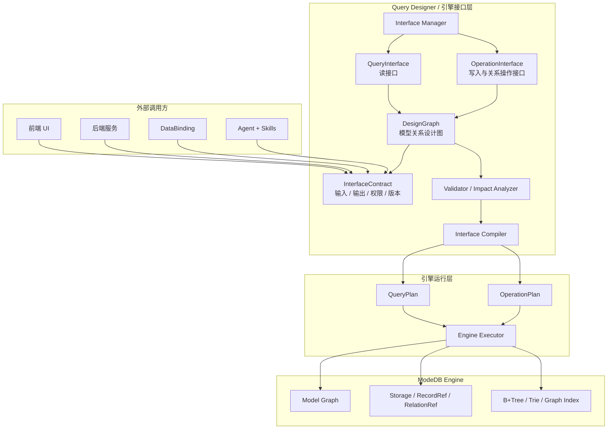
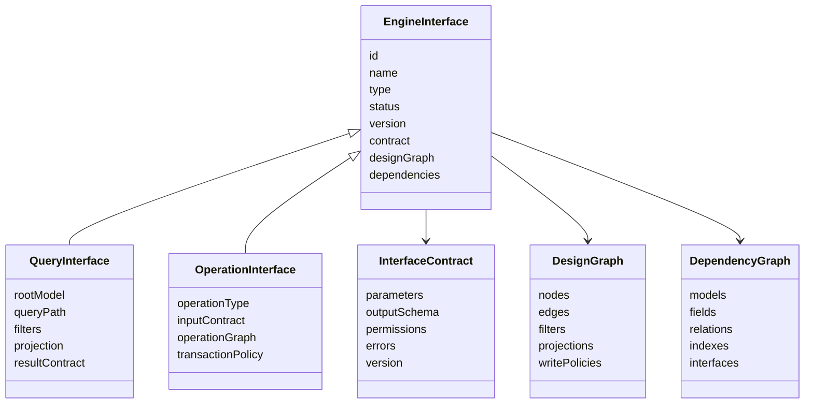
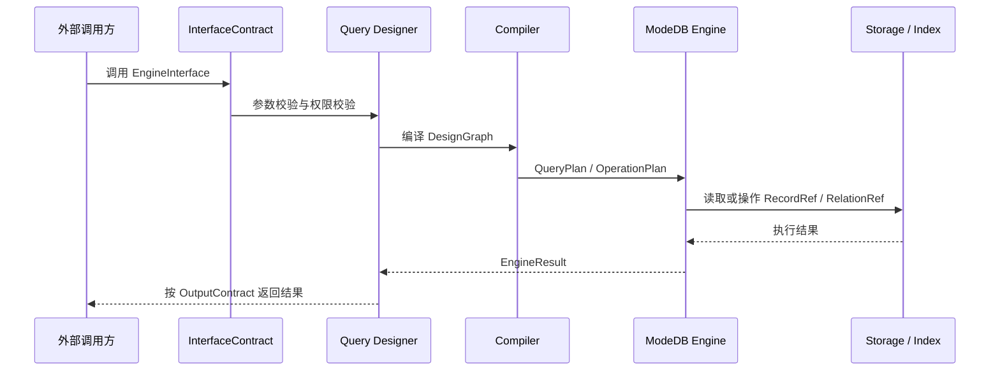
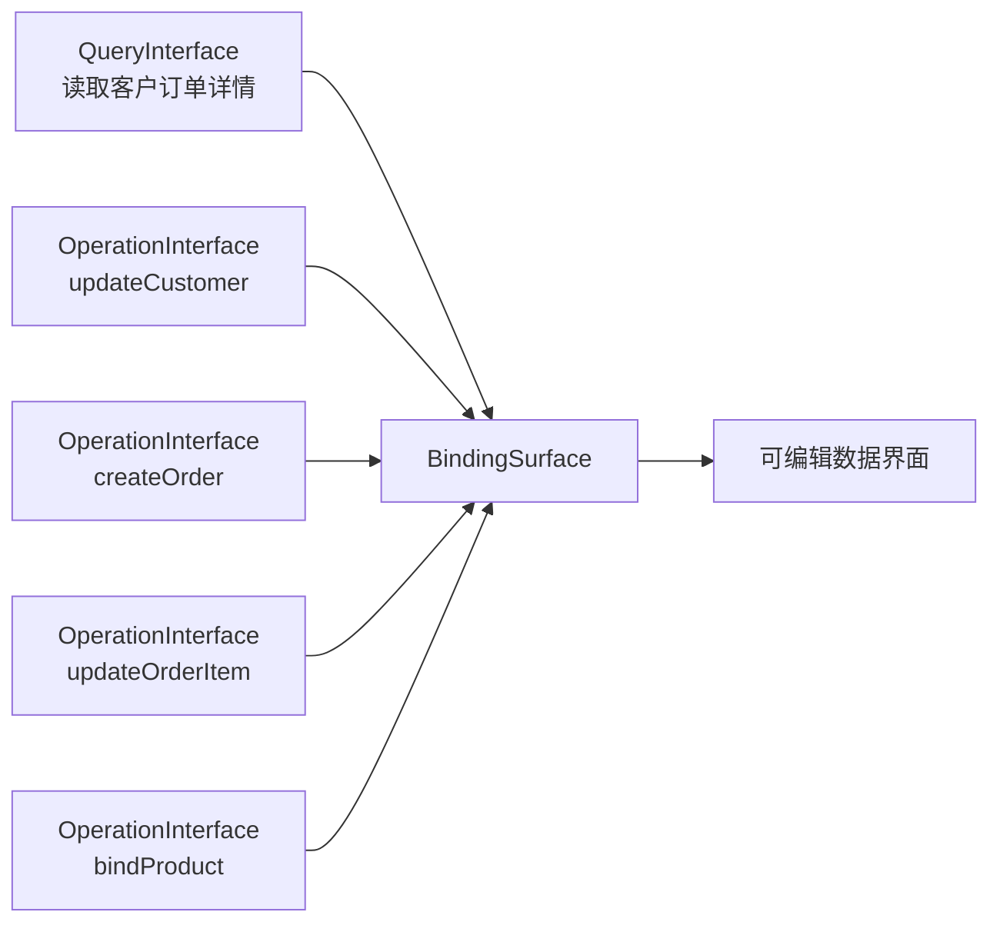

# Query Designer 架构设计 v0.1

## 1. 定位

Query Designer 是 ModeDB 的引擎接口设计器。

它建立在 Model Designer 创建的模型与关系图谱之上，用于设计、管理并编译可调用的 EngineInterface 资产，使前端应用、后端服务、DataBinding 和 Agent 工作流能够通过稳定、可版本化、可审计的接口读取和操作 ModeDB 引擎数据。

简而言之：

```text
Query Designer = ModeDB Engine 与外界之间的 Engine Interface Layer
```

外部调用方不应该直接操作引擎，而应该调用 Query Designer 生成的 EngineInterface 资产。这些资产再被编译成引擎级的查询计划或操作计划。

## 2. 总体架构



## 3. 核心资产模型



## 4. 执行链路



## 5. 模块职责

### Interface Manager

Interface Manager 是所有 EngineInterface 资产的管理中心。

它负责管理：

- QueryInterface 资产
- OperationInterface 资产
- BindingSurface 资产
- 接口版本
- 接口状态
- 依赖关系
- 调用方
- 影响分析
- 执行记录

### QueryInterface

QueryInterface 负责读取引擎数据。

它描述：

- Root model
- Query path 或 rooted graph
- 筛选条件
- 输入参数
- 输出字段
- 结果契约
- 分页
- 排序

### OperationInterface

OperationInterface 负责受控的数据写入与关系操作。

它支持：

- create
- update
- delete
- bind
- unbind
- rebind
- upsert
- batch operation

### DesignGraph

DesignGraph 是 Query Designer 内部保存的设计结构。

它描述：

- 模型节点
- 关系边
- 字段选择
- 筛选条件
- 路径结构
- 写回策略
- 依赖信息

### InterfaceContract

InterfaceContract 是暴露给外部调用方的稳定契约。

它描述：

- 输入参数
- 输出结构
- 错误结构
- 权限
- 版本
- 调用形态

### Compiler

Compiler 将接口资产转换为可执行的引擎计划。

```text
QueryInterface -> QueryPlan
OperationInterface -> OperationPlan
```

## 6. QueryInterface 与 OperationInterface 的关系



QueryInterface 提供读路径。

OperationInterface 提供写路径。

BindingSurface 将 QueryInterface 和 OperationInterface 组合成一个可编辑的数据表面，供 DataBinding 和应用 UI 使用。

## 7. 第一版范围

MVP 应支持：

- 从 root model 创建 QueryInterface
- 建立主链，并支持少量分支
- 选择输出字段
- 添加参数化筛选条件
- 添加排序与分页
- 支持 flat 和 tree 两种结果形态
- 保存接口资产
- 预览接口执行结果
- 分析接口依赖
- 提供基础 Interface Manager

MVP 暂不包含：

- 复杂聚合
- 完整自由图编辑
- 复杂表达式编辑
- 自动写回
- 复杂权限系统
- Agent 自动生成接口

## 8. 建议代码组织

后续实现可以围绕这些概念组织：

```text
query-designer/
  interfaces/
    query-interface.ts
    operation-interface.ts
    engine-interface.ts
  design-graph/
    graph-types.ts
    graph-validator.ts
  compiler/
    query-plan-compiler.ts
    operation-plan-compiler.ts
  manager/
    interface-registry.ts
    version-manager.ts
    impact-analyzer.ts
  binding/
    binding-surface.ts
    writeback-policy.ts
```

## 9. 核心术语

### EngineInterface

Query Designer 生成的可调用接口资产总称。

### QueryInterface

用于查询引擎数据的读接口资产。

### OperationInterface

用于操作引擎数据的写入或关系操作接口资产。

### InterfaceContract

EngineInterface 对外暴露的契约，包括输入、输出、权限、错误和版本。

### DesignGraph

Query Designer 内部用于描述接口设计的模型关系图。

### QueryPlan

由 QueryInterface 编译得到的可执行读计划。

### OperationPlan

由 OperationInterface 编译得到的可执行写入或关系操作计划。

### BindingSurface

DataBinding 使用的读写组合数据表面。

### WritebackPolicy

将 UI 编辑行为映射到 OperationInterface 调用的规则集合。

### DependencyGraph

EngineInterface 依赖的模型、字段、关系、索引和相关接口的依赖图。

## 10. 结论

Query Designer 的真正价值不是可视化查询编辑，而是为 ModeDB 建立稳定的 Engine Interface Layer。

这一层可以避免外部系统直接依赖底层引擎协议。外部调用方通过可管理、可版本化、可审计的接口资产访问和操作 ModeDB。

通过这个设计，DataBinding、DataImport、DataClean、前端应用、后端服务和 Agent 工作流都可以收敛到同一个接口层。
