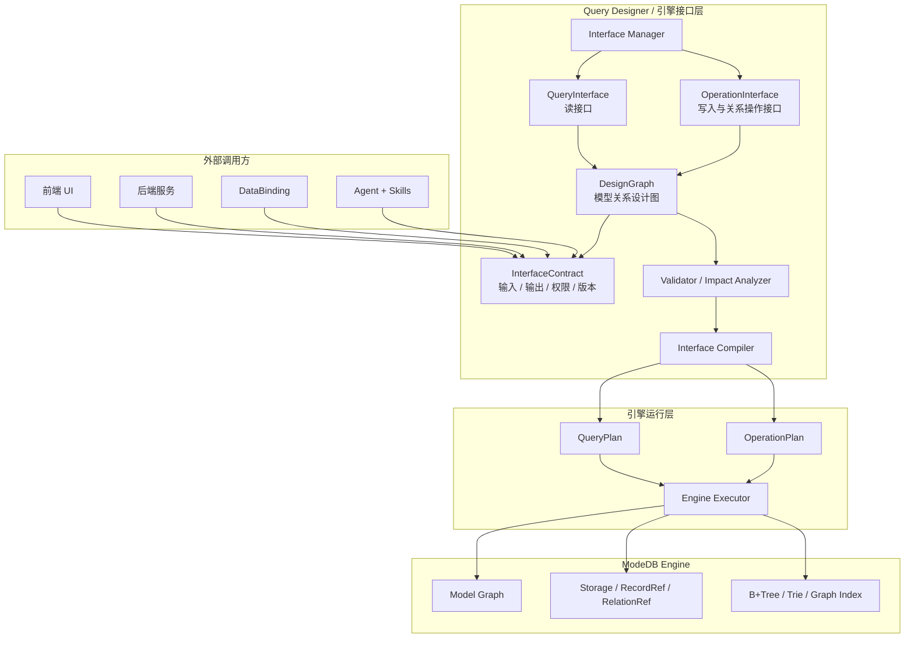
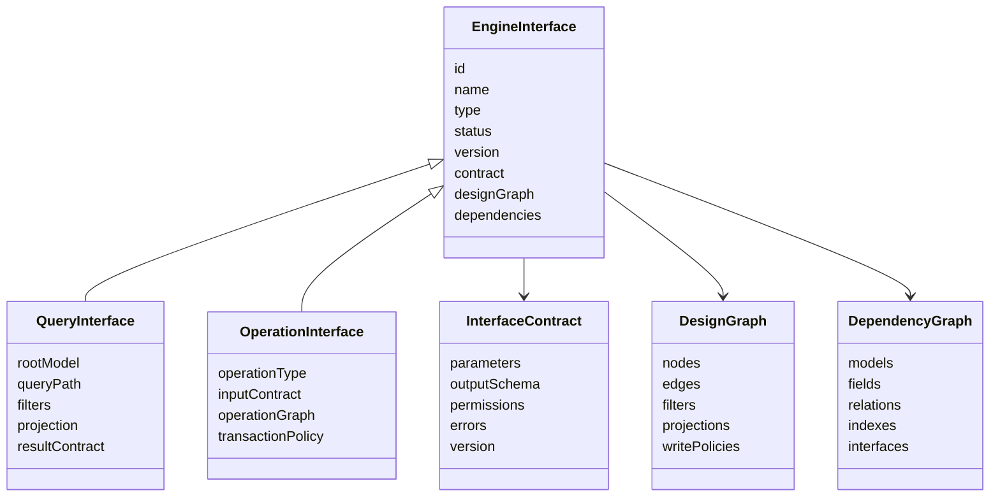
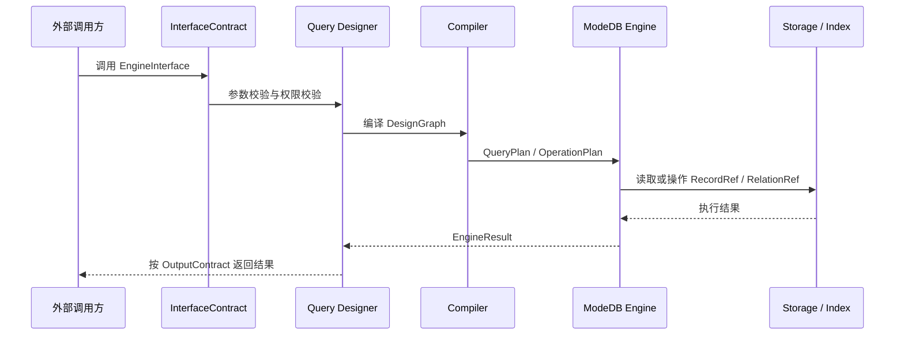
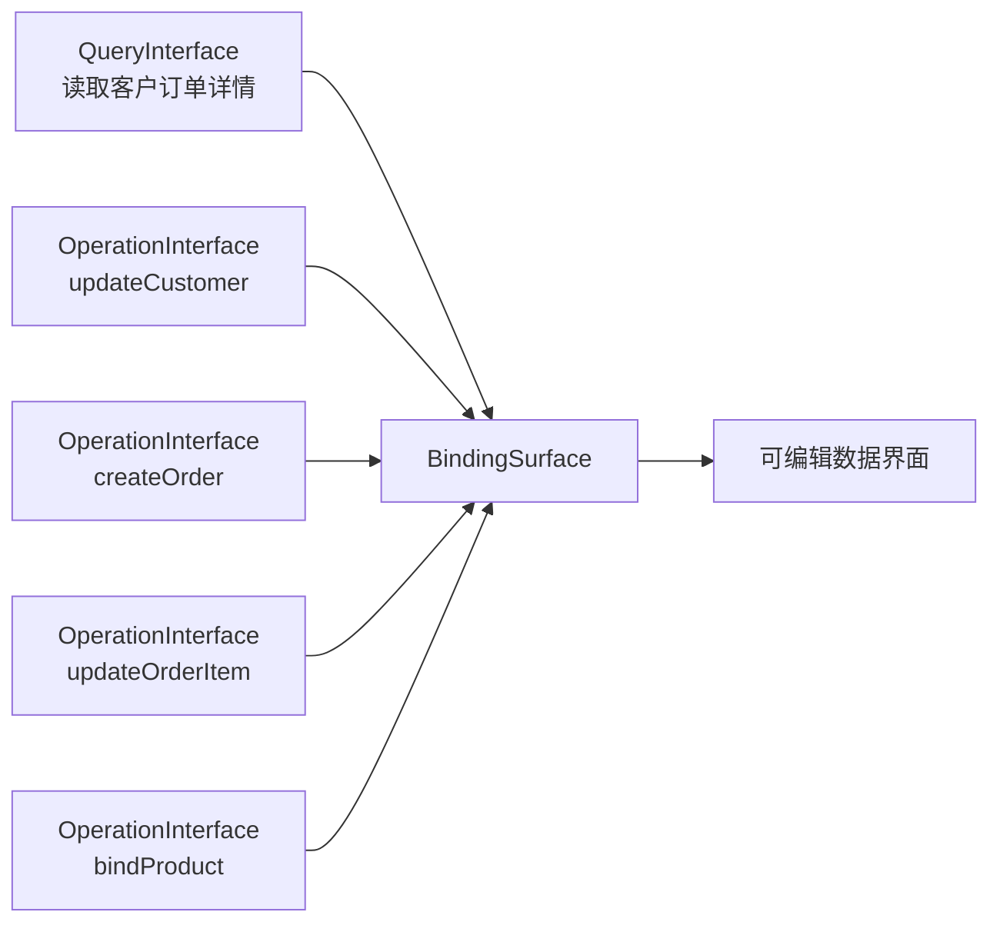
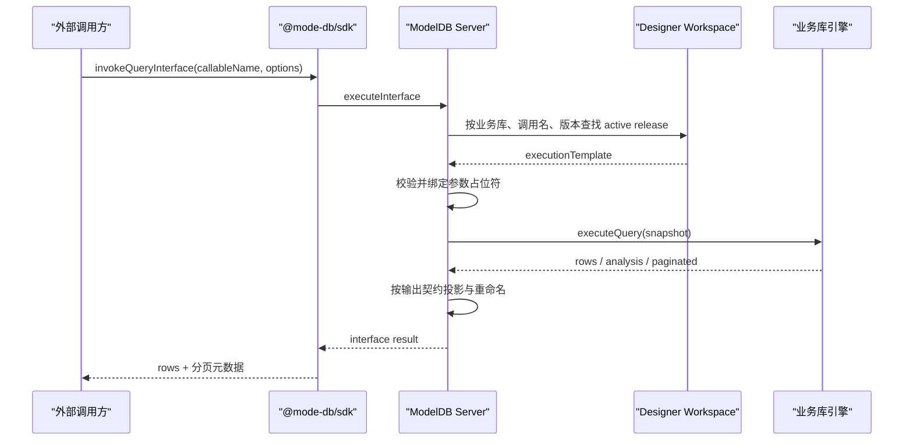

# Query Designer 架构设计 v0.1

## 1. 定位

Query Designer 是 ModeDB 的引擎接口设计器。

它建立在 Model Designer 创建的模型与关系图谱之上，用于设计、管理并编译可调用的 EngineInterface 资产，使前端应用、后端服务、DataBinding 和 Agent 工作流能够通过稳定、可版本化、可审计的接口读取和操作 ModeDB 引擎数据。

简而言之：

```text
Query Designer = ModeDB Engine 与外界之间的 Engine Interface Layer
```

外部调用方不应该直接操作引擎，而应该调用 Query Designer 生成的 EngineInterface 资产。这些资产再被编译成引擎级的查询计划或操作计划。

## 2. 总体架构



## 3. 核心资产模型



## 4. 执行链路



## 5. 模块职责

### Interface Manager

Interface Manager 是所有 EngineInterface 资产的管理中心。

它负责管理：

- QueryInterface 资产
- OperationInterface 资产
- BindingSurface 资产
- 接口版本
- 接口状态
- 依赖关系
- 调用方
- 影响分析
- 执行记录

### QueryInterface

QueryInterface 负责读取引擎数据。

它描述：

- Root model
- Query path 或 rooted graph
- 筛选条件
- 输入参数
- 输出字段
- 结果契约
- 分页
- 排序

### OperationInterface

OperationInterface 负责受控的数据写入与关系操作。

它支持：

- create
- update
- delete
- bind
- unbind
- rebind
- upsert
- batch operation

### DesignGraph

DesignGraph 是 Query Designer 内部保存的设计结构。

它描述：

- 模型节点
- 关系边
- 字段选择
- 筛选条件
- 路径结构
- 写回策略
- 依赖信息

### InterfaceContract

InterfaceContract 是暴露给外部调用方的稳定契约。

它描述：

- 输入参数
- 输出结构
- 错误结构
- 权限
- 版本
- 调用形态

### Compiler

Compiler 将接口资产转换为可执行的引擎计划。

```text
QueryInterface -> QueryPlan
OperationInterface -> OperationPlan
```

当前 QueryInterface 编译链路已经落地：

- 将根模型、字段条件、主链、分支和根节点聚合编译为 wire query snapshot。
- 将多字段排序按优先级编译到 wire snapshot，并在引擎分页前执行；普通查询支持主路径终点字段，聚合查询支持分组维度和指标。
- 将 `ANY / ALL / NONE` 关系量词编译为版本 4 relation predicate，通过关系索引在 Core 中执行。
- 将指标 HAVING 条件编译为版本 5 predicate，在聚合完成后、排序和分页前过滤聚合桶；支持嵌套 `AND / OR` 与参数值。
- 将指标“去重”开关编译为版本 6 distinct aggregate，支持 `COUNT / SUM / AVG / MIN / MAX DISTINCT`，并保留排序与 HAVING 的指标 wire key。
- 聚合可以沿主查询链在终点模型执行；维度和指标统一以主链终点记录为粒度，展示分支不会混入聚合跳转。
- 在执行前统一解析调用参数，并校验必填参数与参数类型。
- 通过协议版本 7 提供游标分页；游标绑定查询条件、排序和结果类型，并支持普通记录与聚合桶稳定续页。
- 对当前协议不能无损表达的能力产生阻断诊断，包括跨节点混合粒度聚合、分支节点直接聚合和仅分支节点字段行排序。
- 执行预览通过业务逻辑库的短生命周期会话调用引擎，并按接口投影映射返回字段。
- Preview 面板展示执行阶段、能力诊断、引擎请求以及表格或 JSON 结果。
- 发布时将 wire query snapshot、参数占位符、输出适配器和分页策略固化为 `executionTemplate`，服务端无需依赖 Model Designer 源码即可执行接口。
- 服务端通过 `executeInterface` 按业务库、调用名和可选版本读取 `model_designer_workspace.sys_query_interface` 中的 active release，绑定参数后在目标业务库执行。
- SDK 通过 `invokeQueryInterface(callableName, options)` 暴露稳定调用入口；HTTP short mode 与 WebSocket 共用同一加密线协议。

编译原则是“不能保证语义一致就阻断执行”，不允许静默降级为含义不同的查询。

## 6. QueryInterface 与 OperationInterface 的关系



QueryInterface 提供读路径。

OperationInterface 提供写路径。

BindingSurface 将 QueryInterface 和 OperationInterface 组合成一个可编辑的数据表面，供 DataBinding 和应用 UI 使用。

## 7. 第一版范围

MVP 应支持：

- 从 root model 创建 QueryInterface
- 建立主链，并支持少量分支
- 选择输出字段
- 添加参数化筛选条件
- 添加排序与分页（分页在查询链确定后设置，设计器界面提供 offset 模式与默认每页数量）
- 支持 flat 和 tree 两种结果形态
- 保存接口资产
- 预览接口执行结果（已发布接口的真实返回结果可在数据透视 Pivot 面板中查看，见 [`pivot-tab-v1.md`](./pivot-tab-v1.md)）
- 分析接口依赖
- 提供基础 Interface Manager
- 发布时生成不可变 QueryInterface release 快照，并保留可继续编辑的草稿版本
- 发布前校验完整接口契约和调用名唯一性，支持发布更新与弃用
- 重新发布前比较当前草稿与已发布契约：元数据或查询行为调整递增 patch，可选参数或输出字段扩展递增 minor，必填参数、参数类型、输出删改、分页模式、调用名或访问策略变化递增 major 并标记为 breaking
- 接口注册表使用 `interface_id` 作为逻辑键、引擎 `_id` 作为存储键，发布快照保存于 `release_json`
- 发布快照携带可序列化执行模板，外部调用方可通过 `callableName + version + parameters` 执行 active release
- 重新发布时将上一版完整快照归档至 `release_history_json`；未指定版本只执行当前版，指定版本时可精确执行仍为 active 的历史版
- 接口调用错误通过 `errorDetail` 返回稳定的 `code / category / retryable / details`，同时保留原 `error` 字符串兼容旧 SDK
- 每次调用写入 `sys_query_interface_call_log` 脱敏审计，只记录调用名、版本、状态、耗时、行数、参数数量和分页模式，不保存参数名或参数值
- 访问策略支持连接认证、接口专属密钥和停用外部调用；专属密钥只保存 SHA-256 摘要，Server 在参数绑定与查询执行前强制校验
- 访问策略可独立配置固定窗口限流；服务端按业务库、调用名和发布版本计数，超限返回带 `retryAfterSeconds` 的可重试结构化错误并写入审计
- Interface Manager 按调用名展示审计摘要，包括总调用、成功、失败、平均耗时和最近错误码
- Interface Manager 展示近 24 小时的 2 小时粒度调用趋势，以及最近 8 次调用的状态、版本、耗时、行数和错误码
- Interface Manager 可直接选择当前或历史 active release 进行在线调试，填写参数与专属密钥后调用真实 SDK 链路，并生成对应的 `invokeQueryInterface` 示例
- Interface Manager 在发布更新前展示兼容性影响、建议版本和具体契约变化，并通过版本台账统一展示当前与历史 release 的状态、兼容性、参数规模和发布时间
- 三类接口资产共用“迁移历史契约 -> 兼容性检查 -> 重新编译 -> 以新版本发布”的回滚语义；回滚不会覆盖当前设计草稿，也不会删除被替换的 release

### 7.1 已发布接口执行链路



运行时在未提供 `version` 时只执行 `publishedRelease`，避免默认调用意外回退；提供 `version` 时会同时检索当前版与 `release_history_json` 中的历史快照。旧格式发布记录若缺少 `executionTemplate`，不会被当作可执行接口；弃用状态也不会被调用。

审计写入采用“业务结果优先”原则：审计模型或写入暂时不可用时，不改变接口本身的成功或失败结果。权限、限流和调用统计可以继续基于该审计模型扩展。

当前 QueryInterface 读取链路已经覆盖嵌套条件、关系量词、聚合、HAVING、去重指标、排序、分页、发布、外部调用、访问策略和审计。后续工作按以下边界继续：

- QueryInterface 收口：普通查询字段排序以主路径终点记录为主体；V1 明确冻结 constraint edge、聚合分支直接过滤、跨节点 OR，以及聚合结果中非分组维度/非指标字段排序。这些能力必须在 Wire/Core 有无损语义后再开放，不做隐式改写。
- QueryInterface V1 已收口：发布影响分类、语义化版本升级、版本台账、历史版本调试、弃用、访问策略、限流和审计均已形成闭环
- OperationInterface：实现 create、update、delete、upsert、bind、unbind、rebind 与批量操作的设计、校验、发布和执行
- BindingSurface V1 契约与持久化阶段已完成：共享 format 1 契约固定 QueryInterface / OperationInterface 的 id、callableName 和 release 版本；Model Designer 编译器校验参数来源、记录引用、字段可写性、模型/关系目标及 UI 触发器与操作类型的一致性
- BindingSurface 发布会重新编译当前草稿，生成不可变 active release；`sys_binding_surface` 以 `surface_id` 为逻辑键、引擎 `_id` 为存储键，保存草稿、签名、当前发布快照和完整版本历史，并按 `library_code` 隔离
- BindingSurface 服务端组合执行已接入：`executeBindingSurface` 按 `surfaceId` 和可选精确版本解析 active release，完成 Surface 参数绑定、固定版本 QueryInterface / OperationInterface 调用、写入后刷新和结构化结果返回
- SDK 已提供 `invokeBindingSurface`；Data Kit 的 `BindingSurfaceSession` 可管理版本、参数、access key、原始行、记录引用和刷新状态；Model Designer 已接入设计、资产与真实执行实验三个视图
- mutation 统一进入服务端写串行门；`afterMutation` 刷新失败时返回 `refreshFailed` 并保留成功的 mutation 结果，调用方不得据此重试写操作
- 暂缓完整自由图编辑、跨粒度复杂表达式、细粒度可信身份权限和 Agent 自动生成接口

OperationInterface 的单记录与关系阶段已经完成：`operation-execution-compiler.ts` 可将
`create / update / delete` 编译为 `insert / update / delete`，将 `upsert` 编译为单行
`insertMany + upsert.matchFields + returning`，并将单关系对
`bind / unbind / rebind` 编译为 `bindPair / unlinkPair / rebindPair`。关系端点通过
`relationSource / relationTarget / relationPreviousTarget / relationNextTarget` 显式标记，
执行时使用 catalog 中稳定的 engine forward/reverse 名称，自关联关系也不会产生端点歧义。
不可变发布快照、版本历史、`sys_operation_interface` 独立注册表、Server 写串行执行、访问策略、
脱敏审计和 SDK `invokeOperationInterface` 已接入。Operation Designer UI 已覆盖八类操作、模型或关系目标、
字段与端点参数、结果契约、访问策略、草稿保存、发布/弃用/删除和真实 SDK 在线调试。`rebind` 保持
source 不变，以 `previousTargetId` 替换为 `nextTargetId`；若建立新边失败，Core 会恢复旧边且只在成功后 flush。
`batch` 已按同构单项操作接入：发布模板固化 item operation、最大项数和失败策略，调用方通过
`items: [{...}]` 提交。`continue` 支持部分成功，`stop` 在首错后停止并报告未尝试项；两者都不是
跨项原子事务。当前 Core 没有跨操作回滚能力，因此 `rollbackOnFailure: true` 会在验证和编译阶段被拒绝，
不会静默降级。稳定结果契约包含整体状态、请求/尝试/成功/失败/跳过计数以及可选逐项结果。

## 8. 建议代码组织

后续实现可以围绕这些概念组织：

```text
query-designer/
  interfaces/
    query-interface.ts
    operation-interface.ts
    engine-interface.ts
  design-graph/
    graph-types.ts
    graph-validator.ts
  compiler/
    query-plan-compiler.ts
    operation-plan-compiler.ts
  manager/
    interface-registry.ts
    version-manager.ts
    impact-analyzer.ts
  binding/
    binding-surface.ts
    writeback-policy.ts
```

## 9. 核心术语

### EngineInterface

Query Designer 生成的可调用接口资产总称。

### QueryInterface

用于查询引擎数据的读接口资产。

### OperationInterface

用于操作引擎数据的写入或关系操作接口资产。

### InterfaceContract

EngineInterface 对外暴露的契约，包括输入、输出、权限、错误和版本。

### DesignGraph

Query Designer 内部用于描述接口设计的模型关系图。

### QueryPlan

由 QueryInterface 编译得到的可执行读计划。

### OperationPlan

由 OperationInterface 编译得到的可执行写入或关系操作计划。

### BindingSurface

DataBinding 使用的读写组合数据表面。

### WritebackPolicy

将 UI 编辑行为映射到 OperationInterface 调用的规则集合。

### DependencyGraph

EngineInterface 依赖的模型、字段、关系、索引和相关接口的依赖图。

## 10. 继承模型在查询链中的等价处理

Query Designer 构建查询链（DesignGraph）时，**继承关系（`modelInherits`）不是一条可遍历的查询步骤**，子模型也**不会**成为独立的查询节点。设计理念是：

> 子模型是父模型的“分身”，二者在查询链上等价。选择子模型只是把已存在的父节点的“身份”改写（rebase）为子模型，从而可以使用子模型独有的字段与关系，而不是新增一个节点。

### 10.1 语义规则

- **继承边不可遍历**：`isInheritRelation(kind)` 为真的边不会出现在“下一步可选关系”列表，也不会被当作 relation step 参与链路推导（见 `query-chain-state.ts` 的 `findRelationStep`、`allQueryRelationPickCandidates`，以及 `query-interface-builder.ts` 的 `outgoingRelationsForModel`）。
- **选择子模型 = rebase 当前节点身份**：当图上已存在某个祖先模型节点，用户再选择它的继承子模型时，走 `rebaseInheritedIdentityToChild`，把该节点（当前实现聚焦于根节点 `rootModelId`）的身份改写为子模型；原本从祖先出发的主关系会被标记为通过继承解析（`QueryGraphRelationUsage.kind = 'inherited'`），而不是新拉一条边。
- **点击继承边**：等同于“选择该边指向的子模型”，交由 `nextQueryChainFromInheritEdge` 处理；若链为空则把子模型设为新的根。
- **安全回退**：如果 rebase 会破坏图（例如让已有关系失去可解析端点），实现会折叠回安全状态而不是产出损坏的查询链。

### 10.2 相关入口

| 关注点             | 入口                                                             |
| ------------------ | ---------------------------------------------------------------- |
| 继承识别           | `isInheritRelation(kind)`（`modelInherits`）                     |
| 祖先定位           | `nearestInheritedAncestorOnGraph`                                |
| 身份改写（rebase） | `rebaseInheritedIdentityToChild`                                 |
| 模型/关系选择入口  | `nextQueryChainFromModelPick` / `nextQueryChainFromRelationPick` |
| 关系用途标记       | `QueryGraphRelationUsage`（`kind: 'inherited'`）                 |

设计侧红线：**任何后续对查询链选择逻辑的改动，都必须保持“继承子模型不新建节点、继承边不可遍历”这一等价性**，否则会让同一实体在链上出现两个语义重复的节点。

## 11. BindingSurface 落地状态

BindingSurface 已形成从设计到执行的完整主链路：

- Model Designer 通过设计、资产、执行三个视图管理读写组合表面。
- 编译器固定 QueryInterface / OperationInterface 的精确 release，并校验触发目标和参数来源。
- 发布记录持久化在 `sys_binding_surface`，保留当前 release 与历史版本台账。
- Server 按 `read` / `mutate` 编排已发布接口，并支持 `manual` / `afterMutation` 刷新策略。
- SDK 暴露 `invokeBindingSurface`，Data Kit 以 `createBindingSurfaceSession` 提供参数、版本、access key、行记录引用和刷新状态管理。
- `refreshFailed` 明确表示 mutation 已成功而随后刷新失败；调用方只能重试读取，不能自动重试写入。

## 12. 结论

Query Designer 的真正价值不是可视化查询编辑，而是为 ModeDB 建立稳定的 Engine Interface Layer。

这一层可以避免外部系统直接依赖底层引擎协议。外部调用方通过可管理、可版本化、可审计的接口资产访问和操作 ModeDB。

通过这个设计，DataBinding、DataImport、DataClean、前端应用、后端服务和 Agent 工作流都可以收敛到同一个接口层。
