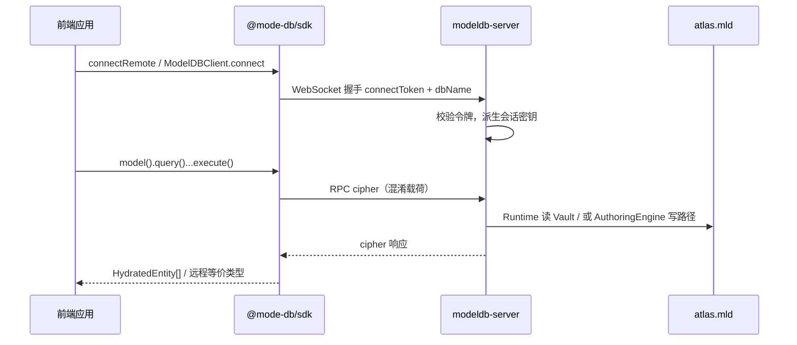

# ModeDB-Ecosystem 操作手册

本文面向 **运维、后端与前端**，说明从 **部署 → 启动 → 新工程接入 → 业务/前端调用** 的推荐路径。实现细节与 API 边界以仓库根目录 **[README.md](../README.md)** 为准；引擎源码在 **`packages/core`**（**`@mode-db/core`**），仓库根 **`package.json`** 为 **pnpm 薄壳**（编排构建与测试）。Meta-DDL 与线协议见 **[engine-meta-crud-and-wire.md](./engine-meta-crud-and-wire.md)**。

---

## 1. 文档目标与架构角色

| 角色                | 职责                                                                                                                       |
| ------------------- | -------------------------------------------------------------------------------------------------------------------------- |
| **运维**            | 准备磁盘工作区、配置 **`modeldb.config.json`**、启动 **`modeldb-server`**、管理 **`connectToken`** 与 Vault 密钥。         |
| **后端 / 数据工程** | 使用 **`AuthoringEngine`** 建模、灌数、**`flushAll`**；或通过已启动的 Server + SDK 做远程写入（若已开放对应 RPC）。        |
| **前端 / 业务应用** | 仅通过 **`@mode-db/sdk`** 连接 Server，执行链式 **只读查询**（及已开放的远程 Meta 操作）；**不**在浏览器内嵌引擎写入路径。 |

**数据形态**：每个逻辑库（图谱）在磁盘上为 **`<workspace>/<dbName>/atlas.mld`** 单文件 Vault；Runtime 与 Server 均通过同一密钥材料解密。

---

## 2. 部署前置条件

### 2.1 运行环境

- **Node.js**：建议 **≥ 20**（与 **`@mode-db/server`** 的 `engines` 一致）。
- **pnpm**：monorepo 使用 **`pnpm-workspace.yaml`**；本地开发在仓库根执行 **`pnpm install`** / **`pnpm run build`**。生产部署可使用 registry 上已发布的 **`@mode-db/server`**、**`@mode-db/core`** 等包，或自源码在 CI 中 **`pnpm run build`** 产出各工作区包下的 **`dist/`**（例如 **`packages/core/dist/`**、**`packages/server/dist/`**）。
- **磁盘**：为 **`workspace`** 预留足够空间；Vault 为整包读写，避免与高 I/O 噪声任务同盘争抢（生产建议独立数据盘）。

### 2.2 你需要准备的密钥

1. **`connectToken`（必填）**
   - 客户端握手时携带，服务端 **`trim` 后全等** 校验。
   - **不**用于解密磁盘；仅用于 **「谁可以连上服务」** 与 **线协议会话密钥派生**（见 **`deriveWireSessionKey`**）。

2. **Vault 密钥（读写 `atlas.mld` 必填）**
   - 治理端：`AuthoringEngine` 的 **`connectToken`**（派生盘密钥）或 **`vaultSecret` / `MODEL_DB_VAULT_SECRET`**。
   - 运行时：**`ModelDBClient.connect`** 读 Vault 时需 **`MODEL_DB_VAULT_SECRET`** 或与集成场景一致的 **`MODEL_DB_CONNECT_TOKEN`**（与 README、**`test/integration-vault.ts`** 对齐）。

生产环境通常 **两者都配置**：网络准入 + 磁盘解密。

---

## 3. 服务端部署（`modeldb-server`）

### 3.1 获取可执行文件

**方式 A：自仓库构建（开发 / 内网制品）**

```bash
git clone <repo-url> && cd <repo-root>   # 目录名与远程仓库名一致（如 mode-db-engine）
pnpm install
pnpm run build
```

可执行入口：

- **`pnpm exec modeldb-server`**（根 **`package.json` → `bin`** 指向 **`packages/server/dist/cli.js`**），或
- **`node ./packages/server/dist/cli.js`**

**方式 B：安装已发布包（若已发布 `@mode-db/server`）**

```bash
pnpm add -g @mode-db/server
# 或 npm install -g @mode-db/server
modeldb-server start --help
```

（具体包名与版本以 registry 为准。）

### 3.2 工作区目录约定

- 配置项 **`workspace`**：逻辑库根目录。
- 每个库：**`<workspace>/<dbName>/`**，内含 **`atlas.mld`**（及可选 **`logs/`** 等）。
- 示例： **`workspace`** = `./digital_chunnel`，库名 **`Asset_Graph`** → 数据路径 **`./digital_chunnel/Asset_Graph/atlas.mld`**。

### 3.3 配置文件

**`modeldb.config.json` 放置位置、`workspace` 与磁盘路径、Windows / Linux / macOS 实践** 见专文 **[modeldb-config-guide.md](./modeldb-config-guide.md)**。

复制 **[modeldb.config.example.json](../modeldb.config.example.json)** 为运行目录下的 **`modeldb.config.json`**，至少修改：

| 字段                      | 说明                                                                                                                                                |
| ------------------------- | --------------------------------------------------------------------------------------------------------------------------------------------------- |
| **`workspace`**           | 逻辑库根（绝对路径或相对 **配置文件所在目录**；无 **`-c`** 时见 **`MODELDB_HOME`**，详 **[modeldb-config-guide.md](./modeldb-config-guide.md)**）。 |
| **`connectToken`**        | 长随机串；与所有合法客户端一致。                                                                                                                    |
| **`port` / `host`**       | 监听地址；公网须配合 **TLS 终结（WSS）** 与防火墙。                                                                                                 |
| **`vaultSecret`**（可选） | 若与 **`connectToken`** 派生策略不同，可单独配置 Vault 口令；也可统一用环境变量 **`MODEL_DB_VAULT_SECRET`**。                                       |

敏感字段 **勿** 提交 Git。

### 3.4 推荐启动命令

在 **配置文件所在目录**（或显式传 **`-c`**）启动，保证相对路径解析正确：

```bash
modeldb-server start --workspace ./digital_chunnel --port 9090 --token 'YOUR_LONG_CONNECT_TOKEN'
```

未写 **`start`** 时，部分版本仍支持将 **`--workspace`** 等直接挂在根命令上（兼容旧用法）；**推荐统一使用 `start`**，便于 systemd / K8s 脚本化。

### 3.5 进程与日志

- 日志目录由配置 **`logDir`** 等决定（见 **[README.md](../README.md)**「运行与配置」）。
- 修改磁盘上的 Vault 或拓扑后，**已运行进程不会自动全量热重载**；变更后请 **重启 Server**。

---

## 4. 治理端：首次灌库与冷数据

在 **可访问 `workspace` 的机器** 上（可与 Server 同机或 CI）：

1. 安装引擎包：在 monorepo 内依赖 **`@mode-db/core`**（**`workspace:*`**，实现位于 **`packages/core`**）；或从 registry 安装已发布的 **`@mode-db/core`**（以实际包名为准）。
2. **`configureModelDBStorageRoot`** 与 **`AuthoringEngine`** 使用 **同一 `workspace` + `dbName`（atlas）+ 同一 Vault 密钥材料**。
3. **`registerModel` / `quickLink` / `insert` / `bind` / `flushAll`**。
4. 确认 **`atlas.mld`** 已生成且 Server 配置的 **`workspace`** 能看到该文件。

之后 **Runtime / Server** 即可对该库做只读查询；若开放远程 DDL，可通过 SDK 调用 **`dropModel`** 等（见 Meta 文档）。

---

## 5. 新工程接入（业务 / 后端服务）

### 5.1 依赖安装

在业务仓库中安装远程客户端（包名以 registry 为准）：

```bash
pnpm add @mode-db/sdk
# 或 npm install @mode-db/sdk
```

**不要**在纯前端或业务服务里依赖 **`@mode-db/server`** 来「顺带启动」数据库；Server 由运维单独进程托管。

### 5.2 环境变量（推荐）

| 变量                         | 用途                                                                           |
| ---------------------------- | ------------------------------------------------------------------------------ |
| **`MODEL_DB_URL`**           | **`http(s)://host:port`** 或 **`ws(s)://host:port`**，供 **`connectRemote`**。 |
| **`MODEL_DB_CONNECT_TOKEN`** | 与 Server **`connectToken`** 一致。                                            |
| **`MODEL_DB_ATLAS`**         | 逻辑库名 **`dbName`**（目录名），与磁盘 **``<workspace>/<dbName>/`** 一致。    |

Server 侧若使用 Vault，业务进程读本地 **`ModelDBClient.connect(atlas)`** 时还需 **`MODEL_DB_VAULT_SECRET`**（与治理端一致）。

### 5.3 最小 Node 调用示例（后端脚本 / BFF）

```typescript
import { connectRemote } from '@mode-db/sdk';

const db = await connectRemote({
  url: process.env.MODEL_DB_URL!, // 如 http://127.0.0.1:9090
  connectToken: process.env.MODEL_DB_CONNECT_TOKEN!,
  dbName: process.env.MODEL_DB_ATLAS ?? 'Asset_Graph',
});

const rows = await db.model('YourModel').query().execute();
console.log(rows.length);
db.close();
```

- **`mode: 'short'`**：无状态 HTTP **`POST /v2/action`**，适合批处理、Serverless。
- 默认 **`stream`**：**WebSocket**，适合长连接与交互式 UI。

---

## 6. 前端调用逻辑

### 6.1 调用链（概念）



### 6.2 浏览器注意事项

1. **URL**：生产应使用 **`wss://`** 或 **`https://`**（短模式），由网关做 TLS；**不要**在公网明文 **`ws://`** 传 **`connectToken`**。
2. **CORS**：若前端与 API 不同源，须在 **Server 前置反向代理** 上配置 CORS，或 **BFF 同源** 转发（前端只调自己的域，BFF 再调 ModelDB）。
3. **密钥**：**`connectToken`** 放在 **环境变量 / 构建时注入的服务端可写配置** 中，**避免** 写死在可被爬取的静态资源里；更敏感策略可用 **BFF 代持令牌**，浏览器只带会话 Cookie。
4. **包体积**：SDK 依赖 **`@mode-db/shared`**；打包工具需处理 **ESM**；Node 下 WebSocket 默认使用 **`ws`** 包（见 SDK README）。

### 6.3 与「链式查询」的关系

前端（或 BFF）侧 API 与进程内 **`ModelDBClient`** 一致：**`db.model(name).query().where(...).execute()`** 等。  
限制：**只读** 路径默认开放；写入、**`bind`** 等仅在服务端挂载 **`AuthoringEngine`** 写门控时可用（见 Server 实现与 Meta 文档）。

---

## 7. 端到端检查清单

- [ ] **`workspace`** 磁盘可写，且包含目标 **`dbName`** 目录。
- [ ] **`atlas.mld`** 已由治理端 **`flushAll`** 生成（或空库首次由 Server 按需创建策略与你们流程一致）。
- [ ] **`connectToken`** 服务端与客户端完全一致（含空格注意 **`trim`** 习惯）。
- [ ] Vault 解密：**`MODEL_DB_VAULT_SECRET`**（或 **`connectToken`** 派生链）与灌库时一致。
- [ ] 防火墙 / 安全组放行 **`port`**；公网已 **TLS**。
- [ ] 集成测试或 **`curl`/脚本** 能完成握手并成功 **`executeQuery`**。

---

## 8. 排障速查

| 现象                                | 可能原因                                                                         |
| ----------------------------------- | -------------------------------------------------------------------------------- |
| 握手立即断开                        | **`connectToken`** 错误或未传。                                                  |
| **`AtlasManifestError` / 解密失败** | Vault 密钥与写库时不一致；或文件损坏。                                           |
| 查不到新数据                        | 治理端未 **`flushAll`**；或 Server 未重启仍持有旧缓存。                          |
| 浏览器连不上                        | 混用 **`http` URL 与 stream 模式**；或需 **`wss`** / 代理路径 **`/v2/stream`**。 |

---

## 9. 延伸阅读

- **`modeldb.config.json` 与 `workspace` 路径（含 Windows/Linux/macOS）**：[modeldb-config-guide.md](./modeldb-config-guide.md)
- 产品能力、链式查询、DX、配置项全集：**[README.md](../README.md)**
- 逻辑库路径与单文件 Vault 概念：**[logical-workspace-and-single-file.md](./logical-workspace-and-single-file.md)**
- **`alterModel` / `dropModel` / `dropRelation`** 与线协议：**[engine-meta-crud-and-wire.md](./engine-meta-crud-and-wire.md)**
- 集成脚本索引：**[test/README.md](../test/README.md)**
