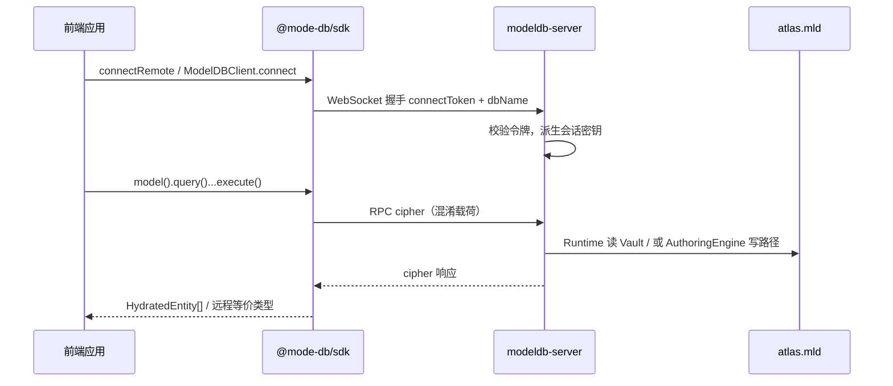

# ModeDB-Ecosystem 操作手册

本文面向 **运维、后端与前端**，说明从 **部署 → 启动 → 新工程接入 → 业务/前端调用** 的推荐路径。实现细节与 API 边界以仓库根目录 **[README.md](../README.md)** 为准；**类与方法级 API** 见 **[developer-handbook.md](./developer-handbook.md)**。引擎源码在 **`packages/core`**（**`@mode-db/core`**），仓库根 **`package.json`** 为 **pnpm 薄壳**（编排构建与测试）。Meta-DDL 与线协议见 **[engine-meta-crud-and-wire.md](./engine-meta-crud-and-wire.md)**。

---

## 1. 文档目标与架构角色

| 角色                | 职责                                                                                                                       |
| ------------------- | -------------------------------------------------------------------------------------------------------------------------- |
| **运维**            | 准备磁盘工作区、配置 **`modeldb.config.json`**、启动 **`modeldb-server`**、管理 **`connectToken`** 与 Vault 密钥。         |
| **后端 / 数据工程** | 使用 **`AuthoringEngine`** 建模、灌数、**`flushAll`**；或通过已启动的 Server + SDK 做远程写入（若已开放对应 RPC）。        |
| **前端 / 业务应用** | 仅通过 **`@mode-db/sdk`** 连接 Server，执行链式 **只读查询**（及已开放的远程 Meta 操作）；**不**在浏览器内嵌引擎写入路径。 |

**数据形态**：每个逻辑库（图谱）在磁盘上为 **`<workspace>/<dbName>/atlas.mld`** 单文件 Vault；Runtime 与 Server 均通过同一密钥材料解密。

---

## 2. 部署前置条件

### 2.1 运行环境

- **Node.js**：建议 **≥ 20**（与 **`@mode-db/server`** 的 `engines` 一致）。
- **pnpm**：monorepo 使用 **`pnpm-workspace.yaml`**；本地开发在仓库根执行 **`pnpm install`** / **`pnpm run build`**。生产部署可使用 registry 上已发布的 **`@mode-db/server`**、**`@mode-db/core`** 等包，或自源码在 CI 中 **`pnpm run build`** 产出各工作区包下的 **`dist/`**（例如 **`packages/core/dist/`**、**`packages/server/dist/`**）。
- **磁盘**：为 **`workspace`** 预留足够空间；Vault 为整包读写，避免与高 I/O 噪声任务同盘争抢（生产建议独立数据盘）。

### 2.2 你需要准备的密钥

1. **`connectToken`（必填）**
   - 客户端握手时携带，服务端 **`trim` 后全等** 校验。
   - **不**用于解密磁盘；仅用于 **「谁可以连上服务」** 与 **线协议会话密钥派生**（见 **`deriveWireSessionKey`**）。

2. **Vault 密钥（读写 `atlas.mld` 必填）**
   - 治理端：`AuthoringEngine` 的 **`connectToken`**（派生盘密钥）或 **`vaultSecret` / `MODEL_DB_VAULT_SECRET`**。
   - 运行时：**`ModelDBClient.connect`** 读 Vault 时需 **`MODEL_DB_VAULT_SECRET`** 或与集成场景一致的 **`MODEL_DB_CONNECT_TOKEN`**（与 README、**`test/integration/vault-env.ts`** 对齐）。

生产环境通常 **两者都配置**：网络准入 + 磁盘解密。

### 2.3 Monorepo 根目录与 `dist/`

在 **ModeDB-Ecosystem** 仓库根：

- **`pnpm run start:server`** 会先执行 **`pnpm run build:server`**，再启动 **`packages/server/dist/cli.js`**，避免未编译时出现 **`Cannot find module ... dist/cli.js`**。
- **`pnpm exec modeldb-server`** 与直接 **`node ./packages/server/dist/cli.js`** 一样，依赖 **`dist/`** 已生成；若你跳过 **`start:server`** 而只用上述入口，请先 **`pnpm run build:server`**（或全量 **`pnpm run build`**）。

**PATH**：`pnpm` 需要能找到 **`node`**。若在 Git Bash 下出现 **`exec: node: not found`**，请换用 PowerShell / Windows Terminal，或修正系统 **`PATH`** 使 **`node -v`** 在所用 shell 中可用。

---

## 3. 服务端部署（`modeldb-server`）

### 3.1 获取可执行文件

**方式 A：自仓库构建（开发 / 内网制品）**

```bash
git clone https://github.com/baoyiwen/ModeDB-Ecosystem.git && cd ModeDB-Ecosystem
pnpm install
pnpm run build
```

日常联调也可在根目录 **`pnpm run start:server`**（会先 **`build:server`** 再启动，见 **[user-handbook.md](./user-handbook.md)**）。

可执行入口（均需 **`packages/server/dist/`** 已存在，除非你用上面的 **`start:server`**）：

- **`pnpm exec modeldb-server`**（根 **`package.json` → `bin`** 指向 **`packages/server/dist/cli.js`**），或
- **`node ./packages/server/dist/cli.js`**

**方式 B：安装已发布包（若已发布 `@mode-db/server`）**

```bash
pnpm add -g @mode-db/server
# 或 npm install -g @mode-db/server
modeldb-server start --help
```

（具体包名与版本以 registry 为准。）

### 3.1b 子命令：`set` / `export-token` / `create-db`

| 命令                                  | 作用                                                                                                                                                                                                                                                                                    |
| ------------------------------------- | --------------------------------------------------------------------------------------------------------------------------------------------------------------------------------------------------------------------------------------------------------------------------------------- |
| **`modeldb-server set <directory>`**  | 将默认数据根写入 **`~/.modeldb/home`**（单行绝对路径）。之后不带 **`-c`** 的 **`start`** 优先使用该目录（仍低于环境变量 **`MODELDB_HOME`**）。目录若尚不存在，**首次 `start` 时会自动创建**完整布局。                                                                                   |
| **`modeldb-server export-token`**     | 读取当前默认主目录（或 **`export-token -c <会话根>`**）下的配置，在 stdout 打印 **`export MODEL_DB_CONNECT_TOKEN=…`**（及 Windows CMD/PowerShell 写法），stderr 提示妥善保存。                                                                                                          |
| **`modeldb-server create-db <name>`** | 在会话根下 **`workspace`**（默认 **`vault/`**）中创建 **`<name>/atlas.mld`**；**不必填写绝对路径**。成功后 stderr 打印**认证与连接指引**（**`connectToken`**、**`export-token`**、SDK **`dbName`**）。可加 **`-c`**、**`-t`**。详见 **[user-handbook.md](./user-handbook.md)** §5.1.1。 |

**认证提醒**：**`connectToken`** 同时用于 **Wire 握手**与 **Vault 密钥派生**；治理端、**`ModelDBClient.connect`**、**`create-db`** 必须使用**同一令牌**（见 **[README.md](../README.md)**「运行与配置」）。

### 3.2 系统默认数据根（`MODELDB_HOME`）与惰性创建

**`@mode-db/server` 不会在 `npm install` / `pnpm add` 时创建任何系统目录**；目录与默认配置文件是在 **进程启动并加载配置** 时，由 **`loadModelDBServerConfig`** → **`resolveModelDbConfigPathFromCli`** / **`ensureModelDbLayoutAtRoot`**（源码 **`packages/server/src/modeldb-default-home.ts`**、**`packages/server/src/config-loader.ts`**）写入磁盘。

| 步骤            | 行为                                                                                                                                                                                                                                                                        |
| --------------- | --------------------------------------------------------------------------------------------------------------------------------------------------------------------------------------------------------------------------------------------------------------------------- |
| 解析数据根      | 无 **`-c`** 时：数据根为 **`MODELDB_HOME`**；若未设置环境变量，则读 **`~/.modeldb/home`**（**`modeldb-server set`** 写入）；再否则为下表 OS 默认目录。配置文件路径恒为 **`<数据根>/modeldb.config.json`**。                                                                 |
| **`-c` 会话根** | **`-c`** 指向**本次启动的临时数据根目录**（其下为 **`modeldb.config.json`**、**`logs/`**、**`cache/`**、**`vault/`**）；若路径为已存在的 **`.json` 文件`**，则按兼容旧版行为，以该文件父目录为会话根。目录或默认 **`modeldb.config.json`** 不存在时会在该根下**自动创建**。 |
| 创建目录        | **`mkdirSync(..., { recursive: true })`**：确保数据根及其子目录 **`logs/`**、**`cache/`**、**`vault/`** 存在（每次解析到该根时执行；与 JSON 是否已存在无关）。                                                                                                              |
| 默认配置文件    | 若 **`modeldb.config.json`** 尚不存在，则**新建**一份 JSON：内含随机 **`connectToken`** 等；**`logDir`**、**`workspace`** 为相对路径 **`logs`**、**`vault`**（相对该 JSON 所在目录解析，避免写死绝对路径）。                                                                |

**默认数据根**（当 **`MODELDB_HOME`** 未设置、且 **`~/.modeldb/home`** 不存在或无效时，与 **`getModelDbHome()`** 一致）：

| 操作系统                | 默认绝对路径语义                                                                                           |
| ----------------------- | ---------------------------------------------------------------------------------------------------------- |
| **Windows**             | **`%LOCALAPPDATA%\modeldb`**；若 **`LOCALAPPDATA`** 未设置，则为 **`%USERPROFILE%\AppData\Local\modeldb`** |
| **macOS**               | **`~/Library/Application Support/modeldb`**（即用户主目录下 **`Library/Application Support/modeldb`**）    |
| **Linux 及其他类 Unix** | **`$XDG_DATA_HOME/modeldb`**；若 **`XDG_DATA_HOME`** 未设置，则为 **`~/.local/share/modeldb`**             |

设置环境变量 **`MODELDB_HOME`** 为任意目录时，上述子目录与默认配置文件均落在该目录下（路径为 **`resolve(MODELDB_HOME)`**），且**不再**读取 **`~/.modeldb/home`**。

**各子目录用途（默认布局下）**：

| 路径                                   | 用途                                                                                                                           |
| -------------------------------------- | ------------------------------------------------------------------------------------------------------------------------------ |
| **`MODELDB_HOME/modeldb.config.json`** | 服务静态配置；无 **`-c`** 时唯一加载路径。                                                                                     |
| **`MODELDB_HOME/logs/`**               | 默认 **`logDir`**；服务端 **`system.log`**、条件开启的 **`access.log`** 等（见 **[README.md](../README.md)**「运行与配置」）。 |
| **`MODELDB_HOME/cache/`**              | 预创建目录；当前默认 JSON 中 **`cacheSize`** 为预留提示，核心逻辑不强制写此路径。                                              |
| **`MODELDB_HOME/vault/`**              | 默认 **`workspace`**（逻辑库根）；各图谱为 **`MODELDB_HOME/vault/<dbName>/atlas.mld`**。                                       |

生产环境建议：显式设置 **`MODELDB_HOME`** 或始终使用 **`-c`** 指向受控路径；将默认 **`connectToken`** 替换为运维发放的密钥并纳入备份策略。

**无 `-c` 时的路径约定**：逻辑库数据与日志目录由会话根下的 **`modeldb.config.json`** 决定；自动生成的模板使用相对路径 **`workspace: "vault"`**、**`logDir: "logs"`**（相对该 JSON 所在目录，即数据根下的 **`vault/`**、**`logs/`**）。**`modeldb-server` CLI 不再提供 `--workspace` / `--storage` / `--db-path`**。无 **`-c`** 时**不会**读取 **`MODEL_DB_WORKSPACE`**、**`MODEL_DB_STORAGE_ROOT`**、**`STORAGE_ROOT`**；若使用 **`-c`** 载入的 JSON 需要自定义盘路径，仍可在该文件内写 **`workspace` / `dbPath`** 等。

**卸载全局包**：执行 **`pnpm remove -g @mode-db/server`**（或 **`npm uninstall -g @mode-db/server`**）时，**`postuninstall`** 会**尽力**删除 **`MODELDB_HOME/cache/`**（不动 **`vault/`**、日志与 **`modeldb.config.json`**）。若进程占用导致删失败，可手动删除该 **`cache`** 目录。

### 3.3 工作区目录约定

- 配置项 **`workspace`**：逻辑库根目录。
- 每个库：**`<workspace>/<dbName>/`**，内含 **`atlas.mld`**（及可选 **`logs/`** 等）。
- 示例： **`workspace`** = `./digital_chunnel`，库名 **`Asset_Graph`** → 数据路径 **`./digital_chunnel/Asset_Graph/atlas.mld`**。

### 3.4 配置文件

**`modeldb.config.json` 放置位置、`workspace` 与磁盘路径、Windows / Linux / macOS 实践** 见专文 **[modeldb-config-guide.md](./modeldb-config-guide.md)**。

复制 **[modeldb.config.example.json](../modeldb.config.example.json)** 为数据根下的 **`modeldb.config.json`**（与 **`logs/`**、**`cache/`**、**`vault/`** 同级），至少修改：

| 字段                       | 说明                                                                                                                                      |
| -------------------------- | ----------------------------------------------------------------------------------------------------------------------------------------- |
| **`connectToken`**         | 长随机串；与所有合法客户端一致。                                                                                                          |
| **`port` / `host`**        | 监听地址；公网须配合 **TLS 终结（WSS）** 与防火墙。                                                                                       |
| **`advertisedHost`**       | 启动输出中展示给客户端的主机名或 IP；只影响提示文字。                                                                                     |
| **`publicBaseUrl`**        | Query Designer 和接口文档使用的公开 HTTP(S) 基础地址；只影响生成的调用链接，不改变监听。                                                  |
| **`workspace` / `logDir`** | 一般保持模板中的 **`vault`** / **`logs`** 即可（相对配置文件目录）；高级场景见 **[modeldb-config-guide.md](./modeldb-config-guide.md)**。 |
| **`vaultSecret`**（可选）  | 若与 **`connectToken`** 派生策略不同，可单独配置 Vault 口令；也可统一用环境变量 **`MODEL_DB_VAULT_SECRET`**。                             |

敏感字段 **勿** 提交 Git。

### 3.5 推荐启动命令

在已 **`modeldb-server set <数据根>`** 或默认 **`MODELDB_HOME`** 就绪后：

```bash
modeldb-server start --port 9090 --token 'YOUR_LONG_CONNECT_TOKEN'
```

临时会话根：**`modeldb-server start -c /path/to/session-root`**。未写 **`start`** 时仍可将 **`--port`** 等直接挂在根命令上（兼容旧用法）。

**局域网调试**：默认 **`host`** 为 **`127.0.0.1`**，仅本机可连。若需同一局域网内其它设备连接引擎，追加 **`--host 0.0.0.0`**（或在仓库根用 **`pnpm run start:server:network`**）监听所有网卡，并放行防火墙对应端口。**公网**部署仍须置于 **TLS 反向代理（WSS）** 之后，切勿以明文 **`ws://`** 暴露到公网。

### 3.6 进程与日志

- 日志目录由配置 **`logDir`** 等决定（见 **[README.md](../README.md)**「运行与配置」）。
- 修改磁盘上的 Vault 或拓扑后，**已运行进程不会自动全量热重载**；变更后请 **重启 Server**。

---

## 4. 治理端：首次灌库与冷数据

在 **可访问 `workspace` 的机器** 上（可与 Server 同机或 CI）：

1. 安装引擎包：在 monorepo 内依赖 **`@mode-db/core`**（**`workspace:*`**，实现位于 **`packages/core`**）；或从 registry 安装已发布的 **`@mode-db/core`**（以实际包名为准）。
2. **`configureModelDBStorageRoot`** 与 **`AuthoringEngine`** 使用 **同一 `workspace` + `dbName`（atlas）+ 同一 Vault 密钥材料**。
3. **`registerModel` / `quickLink` / `insert` / `bind` / `flushAll`**。
4. 确认 **`atlas.mld`** 已生成且 Server 配置的 **`workspace`** 能看到该文件。

之后 **Runtime / Server** 即可对该库做只读查询；若开放远程 DDL，可通过 SDK 调用 **`dropModel`** 等（见 Meta 文档）。

---

## 5. 新工程接入（业务 / 后端服务）

### 5.1 依赖安装

在业务仓库中安装远程客户端（包名以 registry 为准）：

```bash
pnpm add @mode-db/sdk
# 或 npm install @mode-db/sdk
```

**不要**在纯前端或业务服务里依赖 **`@mode-db/server`** 来「顺带启动」数据库；Server 由运维单独进程托管。

### 5.2 环境变量（推荐）

| 变量                         | 用途                                                                           |
| ---------------------------- | ------------------------------------------------------------------------------ |
| **`MODEL_DB_URL`**           | **`http(s)://host:port`** 或 **`ws(s)://host:port`**，供 **`connectRemote`**。 |
| **`MODEL_DB_CONNECT_TOKEN`** | 与 Server **`connectToken`** 一致。                                            |
| **`MODEL_DB_ATLAS`**         | 逻辑库名 **`dbName`**（目录名），与磁盘 **``<workspace>/<dbName>/`** 一致。    |

Server 侧若使用 Vault，业务进程读本地 **`ModelDBClient.connect(atlas)`** 时还需 **`MODEL_DB_VAULT_SECRET`**（与治理端一致）。

### 5.3 最小 Node 调用示例（后端脚本 / BFF）

```typescript
import { connectRemote } from '@mode-db/sdk';

const db = await connectRemote({
  url: process.env.MODEL_DB_URL!, // 如 http://127.0.0.1:9090
  connectToken: process.env.MODEL_DB_CONNECT_TOKEN!,
  dbName: process.env.MODEL_DB_ATLAS ?? 'Asset_Graph',
});

const rows = await db.model('YourModel').query().execute();
console.log(rows.length);
db.close();
```

- **`mode: 'short'`**：无状态 HTTP **`POST /v2/action`**，适合批处理、Serverless。
- 默认 **`stream`**：**WebSocket**，适合长连接与交互式 UI。

---

## 6. 前端调用逻辑

### 6.1 调用链（概念）



### 6.2 浏览器注意事项

1. **URL**：生产应使用 **`wss://`** 或 **`https://`**（短模式），由网关做 TLS；**不要**在公网明文 **`ws://`** 传 **`connectToken`**。
2. **CORS**：若前端与 API 不同源，须在 **Server 前置反向代理** 上配置 CORS，或 **BFF 同源** 转发（前端只调自己的域，BFF 再调 ModelDB）。
3. **密钥**：**`connectToken`** 放在 **环境变量 / 构建时注入的服务端可写配置** 中，**避免** 写死在可被爬取的静态资源里；更敏感策略可用 **BFF 代持令牌**，浏览器只带会话 Cookie。
4. **包体积**：SDK 依赖 **`@mode-db/shared`**；打包工具需处理 **ESM**；Node 下 WebSocket 默认使用 **`ws`** 包（见 SDK README）。

### 6.3 与「链式查询」的关系

前端（或 BFF）侧 API 与进程内 **`ModelDBClient`** 一致：**`db.model(name).query().where(...).execute()`** 等。  
限制：**只读** 路径默认开放；写入、**`bind`** 等仅在服务端挂载 **`AuthoringEngine`** 写门控时可用（见 Server 实现与 Meta 文档）。

---

## 7. 端到端检查清单

- [ ] 若使用 **无 `-c`** 启动：已知晓 **`MODELDB_HOME`** 默认路径（见 **§3.2**），并确认 **`logs/`**、**`cache/`**、**`vault/`** 与自动生成的 **`modeldb.config.json`** 符合备份、权限与合规要求。
- [ ] **`workspace`** 磁盘可写，且包含目标 **`dbName`** 目录。
- [ ] **`atlas.mld`** 已由治理端 **`flushAll`** 生成（或空库首次由 Server 按需创建策略与你们流程一致）。
- [ ] **`connectToken`** 服务端与客户端完全一致（含空格注意 **`trim`** 习惯）。
- [ ] Vault 解密：**`MODEL_DB_VAULT_SECRET`**（或 **`connectToken`** 派生链）与灌库时一致。
- [ ] 防火墙 / 安全组放行 **`port`**；公网已 **TLS**。
- [ ] 集成测试或 **`curl`/脚本** 能完成握手并成功 **`executeQuery`**。

---

## 8. 排障速查

| 现象                                | 可能原因                                                                                                                                                                                                        |
| ----------------------------------- | --------------------------------------------------------------------------------------------------------------------------------------------------------------------------------------------------------------- |
| 用户目录下出现 **`modeldb`** 文件夹 | **无 `-c`** 启动时的预期行为：**`MODELDB_HOME`** 下自动创建 **`logs/`**、**`cache/`**、**`vault/`** 与默认配置（见 **§3.2**）。若不需要，请改用 **`-c`** 指向专用配置路径或设置 **`MODELDB_HOME`** 到受控目录。 |
| 握手立即断开                        | **`connectToken`** 错误或未传。                                                                                                                                                                                 |
| **`AtlasManifestError` / 解密失败** | Vault 密钥与写库时不一致；或文件损坏。                                                                                                                                                                          |
| 查不到新数据                        | 治理端未 **`flushAll`**；或 Server 未重启仍持有旧缓存。                                                                                                                                                         |
| 浏览器连不上                        | 混用 **`http` URL 与 stream 模式**；或需 **`wss`** / 代理路径 **`/v2/stream`**。                                                                                                                                |

---

## 9. 备份、恢复与自动备份

生产部署建议把 `workspace` 所在磁盘纳入系统级快照或异地备份；ModelDB Server 也提供逻辑库级备份文件，用于日常回滚和损坏恢复。

### 9.1 主动备份

```bash
modeldb-server backup <db-name> --reason manual -c <session-root|modeldb.config.json>
modeldb-server backups [db-name] -c <session-root|modeldb.config.json>
```

备份文件位于：

```text
<workspace>/modeldb/backups/*.modeldb-backup.json
```

### 9.2 恢复与清除

```bash
modeldb-server restore <db-name> <backup-file> --yes
modeldb-server clear-data <db-name> --yes
modeldb-server force-reset <db-name> --yes
```

- `restore`：从备份文件恢复当前库，恢复前尽量创建 `pre-restore` 安全备份。
- `clear-data`：清除所有行数据但保留 schema / relation，执行前尽量创建 `pre-clear` 安全备份。
- `force-reset`：后门恢复命令，适合库文件损坏或无法正常打开时重建物理库，执行前尽量创建 `pre-reset` 安全备份。

### 9.3 自动备份

`modeldb.config.json` 不配置 `autoBackup`，或设置 `enabled: false` 时，不会自动备份。

```json
{
  "autoBackup": {
    "enabled": true,
    "intervalMinutes": 60,
    "runOnStart": false,
    "reason": "auto",
    "databases": ["Test_DB"]
  }
}
```

注意：

- `databases` 为空或省略时备份所有逻辑库。
- `intervalMs` 优先于 `intervalMinutes`。
- 最小间隔为 `60000` ms。
- 自动备份仅在 `modeldb-server` 进程运行期间生效。

---

## 10. 延伸阅读

- 开发者手册（引擎与 SDK API）：**[developer-handbook.md](./developer-handbook.md)**
- 使用手册（安装、构建、启动、FAQ）：**[user-handbook.md](./user-handbook.md)**
- **`modeldb.config.json` 与 `workspace` 路径（含 Windows/Linux/macOS）**：[modeldb-config-guide.md](./modeldb-config-guide.md)
- 产品能力、链式查询、DX、配置项全集：**[README.md](../README.md)**
- 逻辑库路径与单文件 Vault 概念：**[logical-workspace-and-single-file.md](./logical-workspace-and-single-file.md)**
- **`alterModel` / `dropModel` / `dropRelation`** 与线协议：**[engine-meta-crud-and-wire.md](./engine-meta-crud-and-wire.md)**
- 集成脚本索引：**[test/README.md](../test/README.md)**
