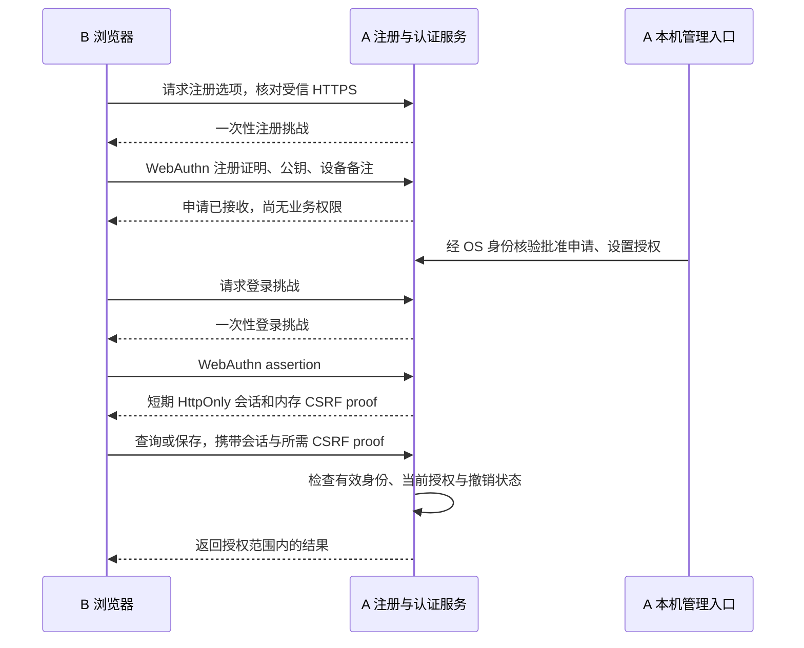

# ModelDB 设备注册与免 Token 连接方案

日期：2026-10-27。状态：DR-P1.1—P1.6 已完成部署/协议、台账/迁移、注册 HTTP 和本机审批 CLI。注册默认关闭，候选经本机批准才登记主体、公钥和明确授权；DR-P2.2 / D19 已完成公钥登录后端/SDK及原生隔离浏览器验证，新增扩展 8/23；正式注册页面尚未实现，未做性能/实际硬件认证器验收。部署见[可信部署契约](device-registration-deployment-contract.md)，操作见[使用说明](device-registration-runtime-guide.md)，状态只记录在[唯一台账](../security-v1-milestones.md)。

## 1. 推荐结论

默认采用“公开连接描述文件 + 浏览器公钥注册 + 本机批准 + 短期会话”。浏览器使用 WebAuthn，用户通常通过 Windows Hello、通行密钥或安全密钥完成确认，无需输入长期 Token。设备列表在第一版准确称为“注册凭证”，可由用户填写设备备注；不声称每条记录必然对应一台独立物理电脑。

需要“只能在这一台 Windows 使用”的客户，再选择本机助手与 TPM 保护的独立模式。两种模式必须在页面和管理端标明保证范围，不默默降级，也不把同步 Passkey 标记为硬件绑定。

不把服务器签发私钥、共享 Token、数据密钥放进下载脚本；不从 MAC、CPU 序号、Windows 用户名等可模拟信息派生认证密钥。设备描述仅辅助管理员识别，私钥持有证明才是认证基础。

| 目标                   | 推荐实现                                        | 适用边界                                     |
| ---------------------- | ----------------------------------------------- | -------------------------------------------- |
| 连接页无需填写 Token   | 首次注册，之后通过公钥认证建立会话              | 操作系统可能要求 PIN、生物识别或安全密钥确认 |
| 新用户不改配置、不重启 | 在安全台账中批准、分配权限、禁用或撤销          | 仍受已设置的网络准入规则约束                 |
| 注册文件周期更新       | 连接描述版本和注册窗口到期控制                  | 不自动使已批准身份失效                       |
| 只有本机维护           | 独立回环管理入口 + Named Pipe 校验 Windows 身份 | localhost 来源本身不授予管理员权限           |
| 数据隔离               | 服务器按主体、库及操作验证权限                  | 通用行级/租户隔离另行设计                    |
| 定向加密交付           | 独立接收方加密密钥，复用现有包加密流程          | 合法接收者解密后仍能复制明文                 |
| 严格主机绑定           | 后续 Windows 本机助手、TPM 和受控注册           | 浏览器默认模式不提供这一保证                 |

## 2. 日常使用体验

### 2.1 A 端首次安装或设置

1. 安装向导让所有者选择仅本机或局域网部署，设置固定访问名称、监听端口、证书和允许的客户端网络；默认只开放本机。
2. 初始化沿用现有受 Windows 保护的实例身份和数据密钥，不为升级中的已有实例重新生成它们。
3. 通过原运行账号的受保护本机入口打开管理页面，显示明确的服务器名称、实例指纹和注册链接。
4. 选择是否开放注册申请。默认需本机批准；普通可访问页面的用户没有数据权限。
5. 以同一 HTTPS Origin 提供 Designer、注册页面和 API，减少跨端口、Origin 和 Cookie 配置；静态页面托管属于待开发交付内容。

向导将部署设置保存到实例目录；已有实例保留其配置、密钥和库关联。监听地址、HTTPS 信任和网络范围仍需所有者确认，不能根据网卡自动猜测后开放所有网络。

### 2.2 B 端首次注册

1. 打开 A 分享的 HTTPS 注册链接，或在 Designer 连接页选择“注册连接”。先确认服务器名称和首次信任信息。
2. 页面可下载公开的 `modeldb-connection.json`，便于稍后导入地址；也可直接继续，不强制下载或执行脚本。
3. 用户设置设备备注，通过浏览器 WebAuthn 注册凭证。认证器生成密钥并保护私钥，服务器只接收公钥及协议证明。
4. B 显示“等待管理员批准”和申请校验信息；此时不能列业务库、查询或保存数据。
5. A 在本机核对申请指纹，通过可信渠道确认申请人，关联用户并分配准确库权限。批准结果持久化后生效。
6. B 重新进行一次登录挑战验证，通过后进入已授权的工作区。批准本身不会直接把业务会话交给公开轮询请求。

有明确邀请对象时，A 可以签发短期、单次邀请。默认仍需本机批准；无人审批的自动邀请作为后续可选策略，不在首版开放。邀请不可用于注册新的管理员身份。

### 2.3 B 端后续连接和保存

有效短期会话可直接恢复连接；会话达到绝对期限、被注销或要求重新确认时，调用 WebAuthn 登录。可以免输 Token，但不承诺永远无感登录。

每次查询、批量操作和保存仍由 Server 检查当前主体、凭证、会话、授权和撤销版本。写入继续经过现有 write gate；客户端不上传私钥或 DEK，不为每条数据重新执行完整 WebAuthn 认证。

“记住服务器”只保存公开地址和实例标识，不把可复用访问秘密放入 localStorage、配置文件或连接描述。

## 3. 系统组成与信任关系

复用当前 `SecurityRegistry`、权限判定、HTTP/WS 边界、审计及备份/资产封装。增加注册申请、公钥凭证及其会话父级关系；不能把 WebAuthn 私钥转换成长期 Bearer Token，再交给浏览器保存。

首版使用成熟 WebAuthn 服务端库和平台 API，锁定依赖并完成协议测试，不自行实现密码算法或 X.509 CA。这里的“连接许可证书”是经过登记、可撤销的公钥身份；无需首先建立自定义证书颁发体系。

## 4. 三类材料与生命周期

### 4.1 公开连接描述

建议只包含格式版本、HTTPS Server Origin、公开实例 ID、固定 RP ID、注册描述版本、到期时间和公开指纹。不得包含私钥、口令、会话秘密、业务路径或权限自授字段。单独邀请秘密通过短期邀请交付，不嵌入公开可下载文件。

建议描述和注册窗口默认 24 小时，服务器在线校验当前版本、实例和到期状态；管理员可提前关闭注册。旧描述到期后需要重新获取才能发起注册，已批准凭证不受此到期影响。复制或修改文件不能跳过在线校验；不能仅校验客户端传来的时间。

公开用户仍可重新下载新版描述，因此这种轮换属于入口版本管理，不能单独限制谁有权注册或访问。访问许可仍来自本机审批和服务器授权；需要限制新申请时关闭注册或使用限定邀请，不能只依靠每天换文件。

导入描述时展示目标 HTTPS 主机，要求用户确认后才访问；不读取任意本地路径，不自动执行命令、不关闭证书校验，也不把已有实例会话发送到新目标。描述经过自签名并不能独立建立首次信任，仍需受信 TLS 和必要的带外实例指纹核对。

注册逻辑运行在可信分发的应用中，描述文件本身是数据。公开注册工具不携带签发秘密，反编译不能产生授权。若未来分发 Windows 助手，需独立完成代码签名、来源校验及防版本回退的更新机制。

### 4.2 长期登记身份

批准记录关联 `principalId`、公钥凭证 ID、实例、备注、状态、策略版本和审计信息；权限由服务器台账维护。默认登记持续有效，直到禁用、撤销、访问重置或显式替换。组织可另设闲置禁用策略，首版不暗中启用。

状态建议为：注册申请 `pending → approved / rejected / expired`；已批准凭证 `active ↔ disabled → revoked`。拒绝、到期或撤销的记录不能通过重复提交注册结果恢复。重新启用须经本机受信管理员明确操作。

重新生成本地凭证属于换钥：新公钥证明、重新确认或审批、持久化切换和旧凭证撤销构成一项明确流程。单纯“再生成一个文件”不影响旧身份。若旧凭证丢失，走本机重新核验，不能仅凭旧设备名称或 MAC 接管。

### 4.3 短期会话

建议首版沿用当前浏览器会话的 30 分钟有效期、8 小时绝对期限、HttpOnly/SameSite/Secure Cookie、CSRF 与会话轮换行为。WebAuthn 认证替换会话建立的证明来源，不能直接复用当前依赖 Bearer 父凭据的到期实现而跳过适配。

续期始终检查主体和登记状态；达到绝对期限后重新执行 WebAuthn。注销立即撤销当前会话，默认不删除登记；“禁用设备/凭证”使对应会话失效；“撤销”需要重新注册审批。

## 5. WebAuthn 的实施条件

默认采用稳定 DNS 名称，例如局域网的 `modeldb-a.home.arpa`，以及客户端信任、覆盖该名称的 HTTPS 证书。RP ID 使用经过验证的固定名称，不从不可信 Host 或转发头动态推导；准确允许的 Origin 由管理员设置。API 和前端同源部署优先。

当前纯 IP、临时网卡地址及可变前端部署不能直接假定可用；应先确定 DNS、证书和实际浏览器兼容性，再开放 WebAuthn 模式。首次仍需建立 HTTPS 信任，注册链接不能自行让浏览器信任未知 CA。

更换 RP 名称可能要求重新注册；改变访问 Origin 也需显式审批和兼容验证。实例 ID 始终参与注册和会话上下文，避免同 RP 多实例混淆。Designer 托管于另一个无关站点、嵌入 iframe 或跨站点 Cookie 的部署不在首版默认范围。

服务器必须核对：至少 32 字节安全随机挑战、建议 60 秒有效期、准确 challenge/RP ID/Origin、预期操作类型、签名、用户存在和 `userVerification: required`。挑战在服务端绑定实例、操作和待注册/登录上下文，并原子地单次消费，覆盖过期、并发、重放、错实例和中途取消。

注册默认不要求设备型号证明，避免收集不必要硬件标识。正确处理备份/同步标志和签名计数器；同步 Passkey 的计数器不能简单作为唯一克隆判据。浏览器身份展示为“公钥凭证”，不能仅凭客户端声明标注 TPM 绑定。

## 6. 本机管理、动态授权和数据隔离

### 6.1 管理入口

建议新增专用管理监听入口，只绑定回环地址（IPv4 `127.0.0.1`，需要时独立支持 IPv6 `::1`）。管理页面、管理会话建立与管理 API 均不暴露到局域网监听器；配置错误或绑定失败不得降级为全网监听。

保留现有 Named Pipe 的 Windows SID/ACL 校验，由原运行账号的本机启动器签发短期管理会话；建议管理会话空闲 15 分钟、绝对 60 分钟后失效，实际实现需单独验证。管理会话不自动获得业务库权限。

服务端同时验证实际连接入口、管理会话、准确 Host/Origin 和 CSRF；不根据请求里的 `127.0.0.1`、`localhost`、角色字段或 `X-Forwarded-For` 赋权。不得通过公开反向代理转发此入口；即使代理连接源是回环，也不能替代 OS 身份证明。拒绝 DNS rebinding、恶意网页跨源调用和远程转发取得管理权限。

### 6.2 动态授权

管理员批准时选择明确的用户、库和能力。默认零业务权限；Designer 使用业务库与 `model_designer_workspace` 的分别授权，查询应用仅授予所需发布接口及准确版本摘要。设备备注、证书内声明的角色及客户端用户 ID 不参与可信授权判定。

同一用户可有多个凭证，一台电脑可有多个用户。不得让设备共用一份全实例身份；禁用一个凭证不应无意撤销该用户全部其他设备，停用用户则撤销其所有会话。管理操作先原子持久化，再反馈成功。

已有网络规则继续作为第一道准入限制。可在首次部署批准一段明确 LAN CIDR，使该范围的新用户无需逐个修改 IP；固定名单之外的客户端仍需管理员动态调整规则，无需重启。注册下载入口的公开范围不得顺带放开数据和管理入口。

### 6.3 隔离范围

首版复用准确库授权和发布接口投影；需要强隔离时优先不同逻辑库、独立每库 DEK。相同业务库内的多用户不自动产生逐行隔离，也不保证共用 Designer 库中的每位用户元数据互相隐藏。共享 Designer 元数据库的隔离范围必须验收；需要私有设计工作区时另立数据模型与授权设计。

通用行级/租户隔离涉及查询、关系遍历、写入、批量、缓存和导出，作为独立后续范围，不在连接认证改造中隐含承诺。

## 7. 密钥用途与备份、转让

| 材料              | 用途与保管方                           | 轮换或禁用的影响                     |
| ----------------- | -------------------------------------- | ------------------------------------ |
| HTTPS 服务端私钥  | A/代理保护网络传输                     | 独立证书维护，不改变用户数据 DEK     |
| 用户/设备认证私钥 | B 的认证器或本机助手保护，签署登录证明 | 撤销在线访问，不直接影响备份解密     |
| 接收方加密私钥    | 接收者独立保管，用于解开交付包内容密钥 | 必须保留历史解密能力或先重封装对应包 |
| 实例 IMK/每库 DEK | A 受保护材料，用于 Vault/本地备份      | 沿用当前维护、历史密钥保留和恢复流程 |

WebAuthn 签名私钥不用于通用数据解密。首版继续使用现有迁移/资产工具创建独立接收方加密密钥，通过可信渠道核对公钥指纹；签名确认该接收公钥归属需要明确授权确认，不能悄悄登记替换。

DR-P4.1 已提供本机公钥关联、独立持有证明、版本与恢复边界，见[密钥契约](recipient-key-contract.md)。DR-P4.2 的离线 CLI 已按“接收方身份 + 已核验加密公钥”选择交付对象，内部仍复用已验收的包格式与密码套件：随机内容密钥加密载荷，接收方公钥保护内容密钥，源/目标各自保留独立密钥域和权限。现有完整迁移包与签名模型资产包的来源验证差异按[使用手册](user-guide.md#5-向受信任实例完整迁移)及[资产说明](user-guide.md#7-模型与-designer-资产包)保留，不泛称所有包已有同一种签名保证。

包关联公开接收方 ID、加密 key ID/版本及源标识，拒绝错接收方、篡改、重放导入和错误版本。不能用普通注册文件解开数据，也不因禁用登录身份删除接收方历史私钥。支持的业务恢复入口不得导回旧访问台账；完整实例灾备保持当前空访问台账、重新注册/授权策略。拥有 OS 权限的攻击者直接回滚整套材料属于现有威胁边界，不能声称仅靠本机文件能够绝对阻止。

丢失接收方私钥可能导致无法解开旧包，需独立的受保护备份或另经批准的恢复接收方。严格不可导出的 TPM 密钥与异机灾备存在取舍：未来必须分别提供“仅原硬件解密”或“另加恢复接收方”的明确策略，不能同时承诺不可复制且丢机器后无条件可恢复。

## 8. 防伪造、滥用与撤销

| 风险                      | 必需防护                                                                  |
| ------------------------- | ------------------------------------------------------------------------- |
| 下载注册文件就得到权限    | 下载无数据权限；服务器批准后才激活登记                                    |
| 伪造设备、复制公开证书    | 验证公钥持有证明、登记状态和实例绑定；设备描述不能赋权                    |
| 签名或邀请重放            | 服务端随机挑战、单次原子消费、上下文与到期校验                            |
| 申请人冒名                | 申请默认待审；管理员带外核对指纹与人员，不只看设备名称                    |
| 注册洪泛和枚举            | 来源与全局限流、挑战/申请/轮询数量上限、过期回收、统一错误、分页管理      |
| 凭证失效后旧会话继续访问  | HTTP/WS/队列执行前校验撤销版本，撤销通知断开长连接                        |
| XSS、伪造页面或被替换工具 | 受信 HTTPS、CSP/依赖检查、输出编码、准确 Origin/RP 校验，禁止任意更新脚本 |
| 同步或复制身份材料        | 默认模式明确保证为凭证持有；严格绑定另用经验证的硬件方案                  |
| 回滚台账/全实例恢复       | 不通过普通备份恢复访问状态；重启/恢复验收不复活撤销记录                   |
| OS 或受信用户会话完全失陷 | 明确为剩余风险；本机钥匙也可能被调用，不承诺抵御全主机控制                |

建议初始上限：每来源每分钟 5 次注册开始、全实例每分钟 60 次、未决申请最多 1000、每申请最多 24 小时、轮询间隔不少于 5 秒。属于待压测调整的初值；多个来源不能突破全局上限，超限不创建材料，旧申请回收不影响已登记身份。

申请查询需绑定独立高熵查询秘密或已验证申请上下文，服务端只存秘密摘要；知道申请 ID 不能查询他人信息。注册和认证失败记录脱敏审计，复用有界聚合及容量保护，不记录原始秘密、完整断言或敏感硬件信息。

禁用、撤销、权限变更与审计需采用现有原子持久化边界；保存失败不能报告成功，结果不明需要核查，不自动重发变更。已提交事务不因撤销宣称能倒退；撤销成功后新开始和排队未执行的操作必须拒绝，长任务的安全检查点需单独测试。

## 9. 严格 Windows 主机绑定增强

此模式在浏览器默认版完成后单独评估。建议由经过代码签名的助手通过 Windows CNG/TPM 创建不可导出认证密钥，并使用 Windows 账号访问控制；没有合格 TPM 或不能验证硬件条件时明确拒绝严格模式，不改成明文文件。

“不可导出”和“只能该硬件使用”需要实际平台验证，不能只信任助手提交的布尔字段；强保证需设计证明、供应链信任和硬件更换流程。DPAPI 软件保护可作为另一个明确命名的较弱模式，不标成 TPM 绑定。

助手不开放任意网站可调用的签名 HTTP 接口，不执行从描述文件接收的 shell 命令，也不把私钥交给 Designer。浏览器与助手如何安全配对、绑定准确实例/Origin、显示签名用途、防止跨站调用及更新回退，须形成独立契约并验收后才能开发接入。

接收方加密采用独立密钥和用途权限。严格模式的不可导出解密、接收包处理和恢复策略也需独立设计，首版不把现有口令保护的可移植接收密钥描述成硬件绑定。

## 10. 性能方案与验证方法

公钥验证集中在注册、登录和必要重新确认；普通查询/保存使用短期会话与内存中的当前权限/撤销索引。撤销提交后同步更新缓存和长连接，重启从持久台账重建；不能使用长期缓存让已禁用身份继续操作。

不为每条模型记录验证一次证书，不因身份改造重新加密整个 Vault。挑战和失败记录有界，过期清理、限流、WebAuthn CPU 和 OS 保护分别计量；不能通过省略关键审计来取得性能通过。

当前 V1 同步审计和 Windows 保护已有明显秒级开销，设备认证不会自动消除。测量须采用隔离候选、相同合成数据和对应基线，分开记录：

- 注册开始/验证/审批、登录/续期、禁用/撤销的服务端 p50/p95 和失败率；用户输入 PIN 的时间另计。
- 普通查询、批量写入、Designer 打开/保存与撤销检查的增量；区分 TLS、签名、台账落盘成本。
- 并发登录/注册洪泛下的内存、CPU、排队、超时与资源上限；注册压力不得饿死本机修复入口。
- 写入与撤销竞争、浏览器刷新、WS 重连、进程中断、磁盘失败及重启后的状态一致性。

性能门槛在基线测量后、独立确认前登记，不在实现结果出来后追认，也不预先承诺零开销或生产容量。本文没有执行上述测试。

## 11. 开发顺序与交付条件

详细任务、依赖、交付出口和状态已在 D08 整理为[开发计划](../security-v1-milestones.md#11-设备注册扩展开发计划)，该台账是唯一进度来源。本方案只保留技术设计，不重复维护任务表。

实施顺序为既有 V1 缺陷修复 → DR-P1 注册审批 → DR-P2 会话/权限 → DR-P3 页面/部署 → DR-P4 加密交付和总验收；严格 TPM 绑定另列 DR-H1。首版新增 23 个子任务，DR-P1.1 已完成，其余运行时能力尚未实现，不计入 V1 原有 20 项完成数。审批先提供现有 OS 保护 CLI，页面和正式同源托管随后接入。

新增实现涉及 Server、shared、SDK、三个前端和相关测试，具体 API、台账版本迁移及依赖在 DR-P1 前冻结契约；严格硬件模式还涉及独立 Windows 分发。无依据不承诺工期。

## 12. 总验收与现有系统衔接

必须在全新临时实例、合成库、随机测试端口和独立浏览器 profile 中验证；最终 A/B 实测也使用隔离实例。不得用真实业务库试验新台账、认证密钥或恢复流程。

1. B 只下载描述时无数据权限；待审身份不能列库，伪造审批字段无效。
2. 同一挑战的并发请求至多成功一次；错 RP、错 Origin、错实例、过期、错签名及公钥替换均拒绝。
3. 本机管理员批准后 B 无需输入 Token 即可连接授权库并保存；复制公开描述不能冒充 B。
4. 分别覆盖同步 Passkey、多浏览器/多用户、丢失凭证和重新注册，不声称浏览器身份绑定物理主机。
5. 禁用/撤销后 HTTP、已有 WS、排队写入和重启均不能获得新的未授权执行；权限收缩覆盖关系、导入导出及发布接口。
6. 远程直连、伪造 localhost/转发头、DNS rebinding、CSRF 和恶意本机网页不能获得管理权限；另一个 Windows 用户不能利用本机来源绕过 SID 校验。
7. 注册文件/邀请到期不误伤已批准身份；描述版本、RP 名称更换、换钥及旧凭证失效行为明确。
8. 接收方身份、加密公钥和包目标核对；中途篡改、错私钥及未知来源按现有包契约拒绝；历史包仍按保留策略可恢复。
9. 注入台账提交失败和进程中断，批准/撤销不会出现未持久化成功；普通恢复不复活旧访问权限。
10. 完成客户端回归、安装/升级副本验证、性能确认、用户文档与两台 Windows 证据，再登记功能交付。

现有 API Token 与配对入口在兼容期保留，服务端程序仍可使用限权 API 凭据；用户可选择逐步登记后撤销旧凭据。已有实例不能静默切换，不自动迁移旧格式 Vault。原材料、历史验收报告和当前 D06 重开事项保留。

DR-P1.1—P1.5 已完成[公共协议与依赖契约](device-registration-protocol-contract.md)、持久台账/迁移、注册 API 和受保护本机审批。注册—待审—批准、重启/故障链路经合成响应和实际 Chrome 虚拟认证器验证；不是 Windows Hello 或新双机验收。下一 DR-P2.1 会话父级模型，再按依赖接公钥登录与正式页面。批准不发放 Token 或会话；none 响应不证明硬件或私钥持有。
